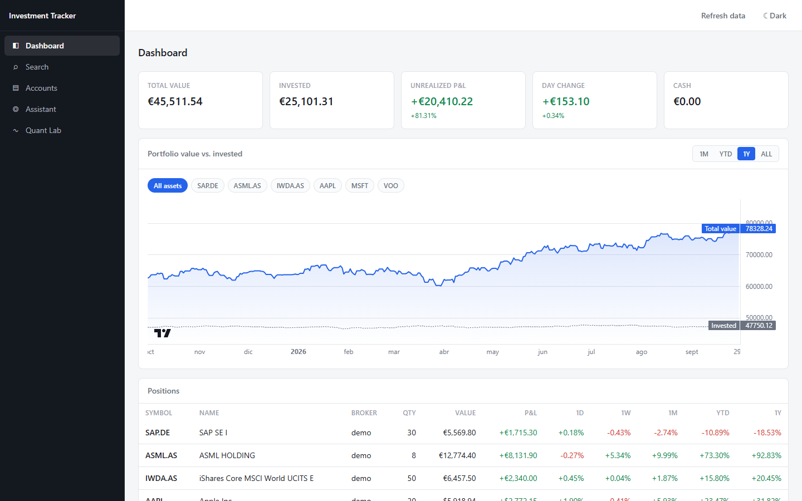
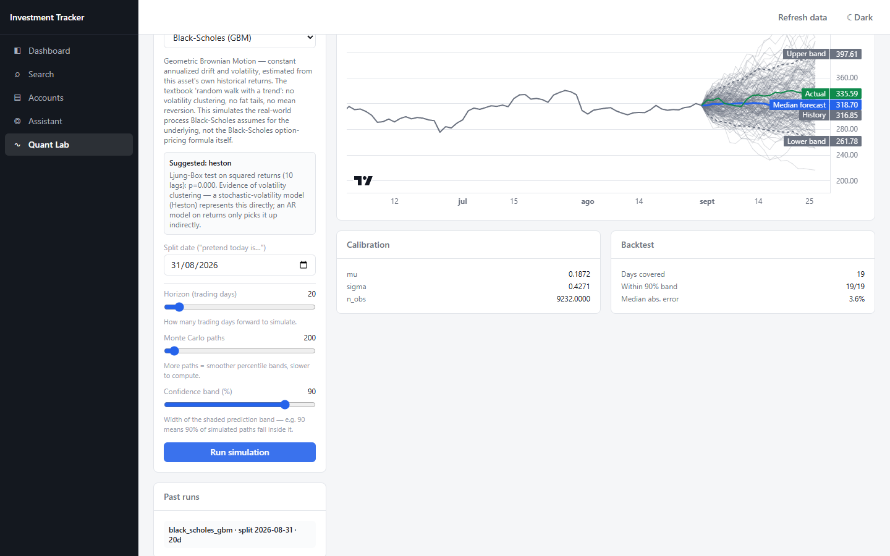
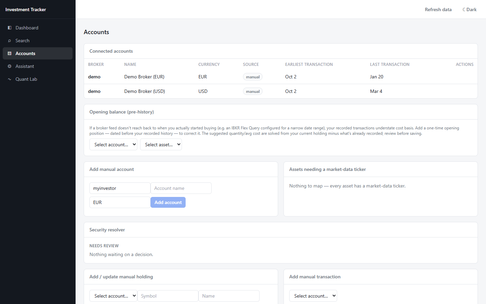
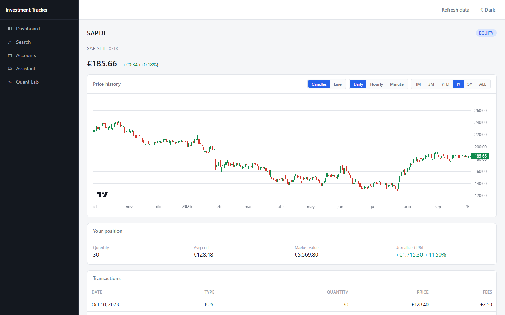
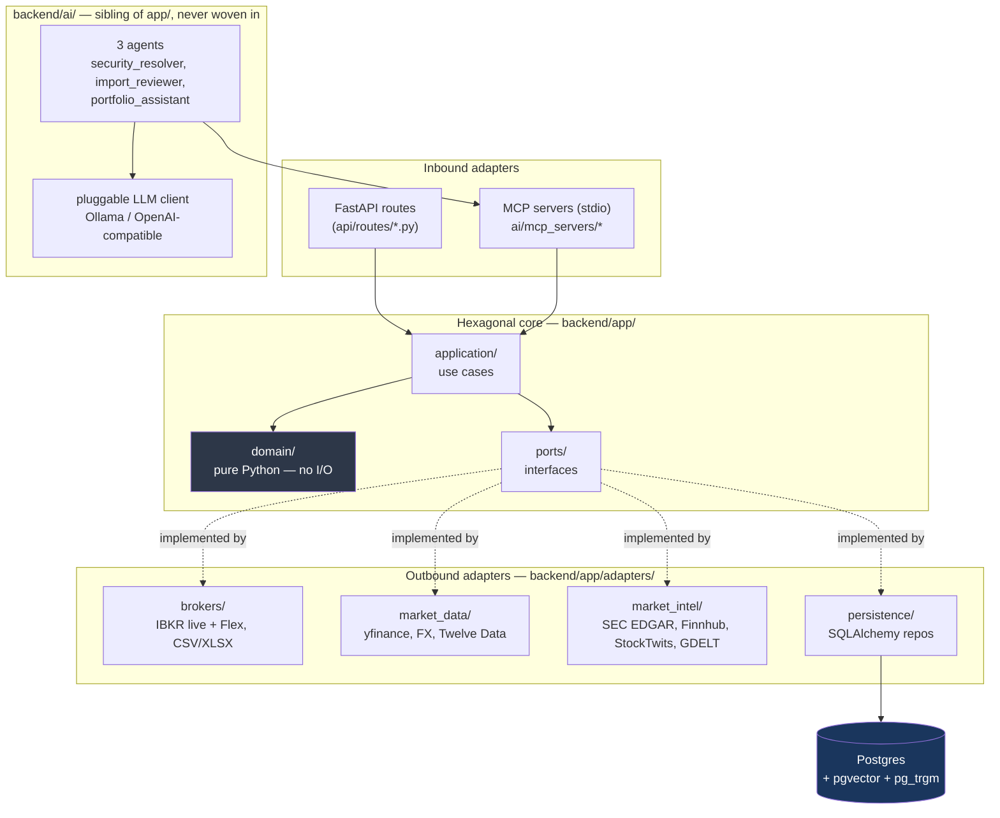

# portfolio-agent-lab

[](https://github.com/aslanda-design/portfolio-agent-lab/actions/workflows/ci.yml)
[](LICENSE)


A local-first, multi-broker investment tracker — and a working laboratory for
agentic LLM systems and quantitative finance models, built end to end by one
person to actually learn both. It syncs real portfolio data (Interactive
Brokers live + full history, or manual/CSV entry for anything without an
API), then layers on top of that real data: a hand-rolled tool-calling agent
runtime, 7 MCP servers, a pluggable quant-model registry with 6 Monte Carlo
models up to Heston and Hawkes jump-diffusion, and retrieval-based tool
selection — none of it a framework wrapper, all of it built to understand the
mechanics, not just call an SDK.

*Screenshots use the built-in synthetic demo portfolio (`backend/scripts/seed_demo_data.py`), not real holdings.*





<details>
<summary>More screenshots</summary>





</details>

## What's actually interesting here

### An agentic layer built from scratch, not a framework

- **One hand-rolled tool-calling loop** (`backend/ai/common/agent_loop.py`)
  serves every agent in the app — both single-shot task agents
  (`terminal_tools={...}`, ends when the model calls a designated "done"
  tool) and a conversational chat agent (`terminal_tools=None`, ends on the
  model's first plain-text reply), with optional session-memory replay. No
  LangChain/LlamaIndex — this loop is ~150 lines and every line is
  understood.
- **7 MCP servers, 30+ tools**, one per bounded context (security
  resolution, portfolio reads, market data, analytics, notes, quant models,
  external market intel), each tool a thin wrapper — open a DB session, call
  one use-case method, serialize, return. No business logic in a tool.
- **A pluggable, provider-agnostic LLM client** (`ai/common/llm.py`) — Ollama
  locally or any OpenAI-compatible hosted API (Groq, etc.), swapped via one
  `.env` variable, never a code change.
- **Retrieval-based tool selection (Tool RAG)** — a `tool_index` table
  (pgvector + `pg_trgm`), hybrid dense+lexical candidate generation fused by
  Reciprocal Rank Fusion, and a selection policy (pinning, token-aware
  budget, per-server diversity cap, confidence-threshold fallback to
  "expose everything"). Every turn's retrieval trace is persisted for audit.
  Off by default at this app's current ~30-tool scale — see
  [`plans/tool_rag.md`](plans/tool_rag.md) §1.1 for the honest reasoning —
  but built and tested, not just designed.

### Deterministic first, LLM only where it earns its keep

The security resolver — deciding which market-data listing prices a broker
holding — is entirely rule-based (OpenFIGI + a scored candidate model,
[`domain/listing_scoring.py`](backend/app/domain/listing_scoring.py)) and
only escalates genuinely ambiguous cases to an agent. `recommend_model` for
the quant lab is a Ljung-Box test, a trend R², and excess kurtosis — cheap
statistics, no prompt. This isn't a stated principle without evidence behind
it: evaluating the security-resolver agent offline against
`mistral:latest` (not tool-tuned) scored **0/6** — and the deterministic
fallback caught every one of those failures cleanly. `qwen3:8b` scored
**5/6, 0 safety violations, 100% terminated_ok**. Rules-first isn't a
hedge here; it's load-bearing.

### Quantitative models with honest calibration, not decoration

| Model | Family | Fitted from history | Manual (literature-typical) |
|---|---|---|---|
| `linear_regression` | regression | OLS on lagged returns/vol/mean | — |
| `time_series_ar` | time series | AR(p) via statsmodels | — |
| `black_scholes_gbm` | stochastic process (**exact**, closed-form) | μ, σ | — |
| `heston` | stochastic process (Euler discretized) | μ, v₀, θ | κ, ξ, ρ |
| `rough_heston` | stochastic process (fractional kernel) | μ, v₀, θ, **H** (Hurst) | κ, ξ, ρ |
| `hawkes_jump_diffusion` | GBM + self-exciting jumps | μ, σ, jump μ/α/β (MLE, if ≥8 events) | threshold_k |

Every model produces a Monte Carlo **path ensemble**, backtested against
real holdout data. Two things are deliberate, not accidental gaps: Heston's
and rough Heston's `κ`/`ξ`/`ρ` are never fitted — a price series alone can't
reliably identify them without an options-implied-volatility surface this
app has no source for, so they're honest sliders, not numbers that look
calibrated but aren't. And Hawkes falls back to literature-typical defaults
below `MIN_EVENTS_FOR_MLE=8` detected jump days rather than reporting an MLE
fit that looks precise but isn't — every run records which happened
(`calibration_diagnostics["source"]`).

## Architecture



**One-way dependency rule**: `domain` imports nothing from this app.
`application` imports `domain`/`ports` only — never `adapters`, never
FastAPI/SQLAlchemy. `container.py` is the only module that wires a port to
its concrete adapter. `ai/` may import from `app/` via `container`'s
factories; nothing under `app/` imports `ai/` except `container.py` itself.
Full detail in [`backend/AGENTS.md`](backend/AGENTS.md).

## How correctness is actually verified

**562 backend tests**, not just "doesn't crash" checks:

- Simulation math checked against **closed-form solutions**:
  [`test_black_scholes_gbm_model.py`](backend/tests/test_black_scholes_gbm_model.py)
  verifies simulated percentiles against the exact lognormal quantile
  formula; [`test_heston_model.py`](backend/tests/test_heston_model.py)
  verifies Heston collapses to that same GBM closed form at `ξ=0, v0=θ` — a
  structural fact, not a tuned tolerance; `test_hawkes.py` checks a stable
  process's long-run event rate against its closed-form stationary
  intensity, plus a simulate-then-recover-the-parameters round trip.
- `Decimal`-only money end to end ([`domain/money.py`](backend/app/domain/money.py))
  — this is a finance app; float rounding error compounds silently across
  history rebuilds.
- Schema is Alembic-versioned, never `create_all()`.
- External-data MCP tools (`market_intel`) take a bare symbol/topic string
  and nothing else, never an internal id, never called in a loop over a
  user's holdings — an egress guarantee that's structural, not just
  reviewed (`backend/ai/AGENTS.md` rule 13).
- CI (badge above) runs the full suite against a **real Postgres +
  pgvector**, not a mock, on every push.

## Quickstart

```bash
git clone https://github.com/aslanda-design/portfolio-agent-lab.git
cd portfolio-agent-lab
cp backend/.env.example backend/.env
docker compose up --build
```

- Frontend: <http://localhost>
- Backend API: <http://localhost:8000>
- pgAdmin: <http://localhost:5050> (`admin@investment-tracker.app` / `admin`)

Seed it with a sample multi-currency portfolio so every page has real data
to show (Dashboard, Quant Lab, Accounts, Asset detail):

```bash
docker compose exec backend python scripts/seed_demo_data.py --yes
```

**Everything above works with zero API keys.** Optional extras, each
independently gated and clearly degrading without it:

| Extra | Unlocks | Setup |
|---|---|---|
| Ollama (local) or an OpenAI-compatible API key | The 3 LLM agents (`AGENT_ENABLED=true`) | [`backend/AGENTS.md`](backend/AGENTS.md) "Running locally" |
| Interactive Brokers (TWS/Gateway) | Real live broker sync | Paper account, port 7497 |
| `FINNHUB_API_KEY` | One of two fused sentiment sources (`MARKET_INTEL_ENABLED=true`) | Free tier at finnhub.io |
| `TWELVE_DATA_API_KEY` | Quant Lab calibration backfill when yfinance history is short | Free tier, 800 req/day |

## Project layout

```
backend/    Python (FastAPI), hexagonal (ports & adapters) — backend/AGENTS.md
  app/        domain / ports / application / adapters / api
  ai/         MCP servers, agents, the shared agent runtime — backend/ai/AGENTS.md
frontend/   React 19 + TypeScript (Vite), token-driven theming — frontend/AGENTS.md
database/   Postgres schema rationale, migrations — database/AGENTS.md
docs/       Concept studies: agentic-systems techniques paired with this repo's own code — docs/README.md
plans/      Design documents for every feature, several with "as built vs. as designed" notes
```

## Documentation index

- [`AGENTS.md`](AGENTS.md) — full architecture, security rules, and a
  phase-by-phase build roadmap with what's verified against real data vs.
  fixtures
- [`docs/README.md`](docs/README.md) — 7 concept studies (MCP/agents, prompt
  injection, semantic caching, long-term memory, planning, feedback loops,
  graph-based reasoning), each pairing the general technique with the real
  file here that implements part of it
- [`plans/`](plans/) — the design record for every feature, several written
  up *after* shipping with what changed from the original plan and why

## Status and honest limitations

- IBKR sync is written and unit-tested for error handling, but not yet run
  against a live paper account end to end.
- MyInvestor CSV import is verified against one real export shape (a
  buy-order export); a sell/dividend export may use different headers —
  the import preview names exactly what it saw, so extending it is a
  copy-paste job, not a guess.
- yfinance is an unofficial scraper, not a supported API — it throttles and
  breaks silently on upstream changes. The security resolver works around
  its weak search coverage by building the Yahoo symbol directly from
  OpenFIGI's exchange code rather than trusting Yahoo's own search.
- No tax lots, no time-weighted returns — average cost basis and simple
  price returns only, a deliberate v1 scope, not an oversight.

Full phase-by-phase status, including what's been verified against real
data versus fixtures only, lives in [`AGENTS.md`](AGENTS.md)'s roadmap.

## License

[MIT](LICENSE)
