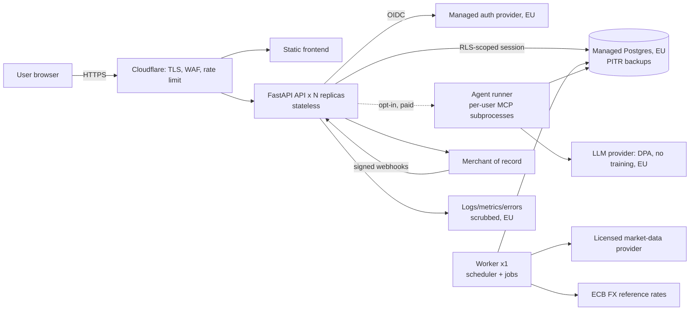
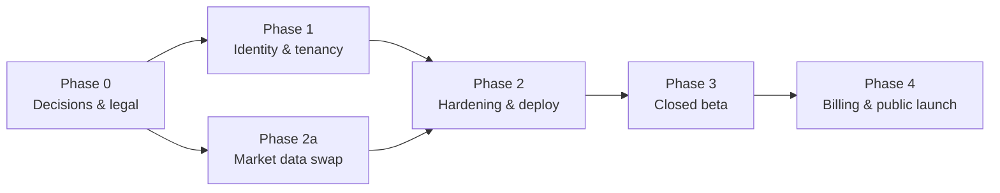

# Plan: from local single-user app to EU-hosted B2C SaaS

> **Status:** draft for review · **Date:** 2026-10-04 · **Owner:** founder
> Decisions behind this plan are recorded in `docs/adr/0001`–`0007` and the
> vocabulary in `CONTEXT.md`. The *why* of every section lives in
> `docs/saas/` (read in order; `docs/saas/README.md` is the index).
>
> **Not legal advice.** Legal and regulatory sections describe what to look at
> and what is typical; a Spanish lawyer must review the legal documents
> before launch (Phase 0 includes that).

## 1. Settled decisions (from the grilling session)

| # | Decision | Record |
|---|----------|--------|
| Q1 | **Informational use only.** No buy/sell/hold recommendations anywhere; disclaimers and tested output constraints. | ADR 0001 |
| Q2 | **EU/EEA-only launch, EU hosting**, autónomo or SL, EU VAT through a merchant of record. | ADR 0002 |
| Q3 | **Freemium.** Free tier (1–2 Brokerage Accounts, no AI); paid tier. Merchant of record for billing. | `09-billing` |
| Q4 | **Import-only at launch**, no stored broker credentials. Flex-token Sync later, behind envelope encryption. | ADR 0003 |
| Q5 | **Core + Quant Lab at launch; AI is opt-in and paid.** Agents off by default. | `07-production-ai` |
| Q6 | **Managed EU stack**, separate staging and production, CI/CD from GitHub Actions. | `08-operations` |
| Q7 | **Managed auth provider** (EU residency), email+password and Google, optional TOTP/passkeys. | ADR 0004 |
| Q8 | **Private vs Reference data**, `user_id` + Postgres RLS, cross-tenant leak test in CI. | ADR 0005 |
| Q9 | **User** = login, **Brokerage Account** = broker side. Rename in code and UI. | `CONTEXT.md` |
| Q10 | Production starts empty; the founder imports like any user. | — |
| Q11 | Hard-delete within 30 days of deletion; self-serve JSON/CSV export; logs carry no financial values. | `05-gdpr-and-legal` |
| Q12 | AI is opt-in with explicit consent, DPA/no-training provider, per-user token quota. | `07-production-ai` |
| Q13 | Full security baseline + STRIDE threat model + ASVS Level 1 pre-launch check. | `04-security` |
| Q14 | Founder drafts legal documents; a Spanish lawyer reviews before launch. | `05-gdpr-and-legal` |
| Q15 | Asset entry: verified → shared table via resolver; anything else → **private custom asset**. | ADR 0005 |
| Q16 | **Licensed market data is a launch blocker.** | ADR 0006, `06-market-data-licensing` |
| Q17 | Phases 0–4 below; master plan + `docs/saas/` set. | this file |

## 2. Where the app is today (verified in the repo, 2026-10-04)

- **No identity.** None of the 22 tables has a user owner; no route is authenticated; CORS is `localhost` only (`backend/app/main.py`).
- **One seam for the database.** Every route does `db: Session = Depends(get_db)` and builds use cases through `app/container.py`. This is the natural place to add "who is the caller" (`backend/app/adapters/persistence/session.py`).
- **The agents bypass that seam.** `ai/agents/*/agent.py` open `SessionLocal()` directly (7 call sites), and the MCP servers are stdio subprocesses with their own DB access. Tenancy must be threaded through them explicitly (ADR 0007).
- **Runtime concerns that break with >1 replica:** `lifespan` runs Alembic on boot and starts an in-process APScheduler (`app/main.py`, `app/adapters/scheduler.py`) — with two API replicas every job would run twice and migrations would race.
- **Single-tenant secrets and sources:** IBKR Flex token in `.env`, live IBKR adapter needs a local TWS socket, `yfinance`/Finnhub/StockTwits are personal-use sources, agents call a local Ollama.
- **Reference vs private data:** `assets`, `asset_identifiers`, `prices`, `quotes`, `fx_rates`, `asset_resolutions`, `resolution_candidates`, `tool_index`, `asset_intel_cache` are public facts. Everything else is Private data.

## 3. Target architecture (one picture)

Details and the reasoning for each box: `docs/saas/01-architecture.md`.

## 4. Phases

Effort is a rough solo-developer estimate in focused weeks, to be re-estimated at each phase boundary.

### Phase 0 — Decisions and legal groundwork (≈2 wks, mostly non-code)

| Task | Output | Exit criterion |
|------|--------|----------------|
| Market-data vendor inquiry (3+ vendors, written answers) | comparison table in `06` | One vendor's written terms allow B2C EOD display to EU consumers; price known |
| Pick auth provider (1-day spike with FastAPI JWT verification) | ADR 0008 | Provider picked, EU residency confirmed in writing |
| Pick hosting + managed Postgres (EU) | ADR 0009 | Region, PITR, price confirmed |
| Pick merchant of record | ADR 0010 | Accepts the product category; fees known |
| Pick LLM provider for opt-in AI (or defer AI) | ADR 0011 | DPA + no-training + EU endpoint in writing, or AI deferred past launch |
| Legal entity & tax setup (autónomo/SL), LSSI-CE identification data | — | NIF, address, contact email ready for the site footer |
| Draft legal pack (ToS, Privacy, Disclaimer, ROPA, DPIA, breach runbook) | `docs/legal/` drafts | Lawyer booked for review |
| Domain, email (SPF/DKIM/DMARC), company mailbox for DSAR/support | — | Working `privacy@` and `support@` |

### Phase 1 — Identity and tenancy in code (≈4–5 wks)

Goal: two real users on a local stack cannot see each other's data; proven by tests.

1. **Schema (migrations `0009`+; expand → backfill → contract):**
   - `users(id uuid pk, idp_subject text unique, email, created_at, deleted_at, plan)`.
   - Add `user_id uuid` to every Private-data table (accounts, holdings, transactions, cash_balances, position_snapshots, portfolio_snapshots, ai_notes, chat_sessions, chat_messages, quant_runs, agent_runs). Denormalise it onto child tables (holdings, transactions…) so every policy is a plain equality — see `02`.
   - `assets.owner_user_id uuid null` for private custom assets, with partial unique indexes replacing the global `symbol` / `isin` uniqueness (Q15).
   - Create DB roles: `app_owner` (migrations), `app_user` (runtime, `NOBYPASSRLS`), `app_worker`.
   - `ENABLE` + `FORCE ROW LEVEL SECURITY` and policies per table; deny-by-default.
2. **Request identity:** `get_current_user` dependency (JWT/session → `users` row, auto-provision on first login); new `get_db` that opens the transaction and sets `app.user_id` via an `after_begin` hook (survives mid-request `commit()`).
3. **Repositories:** every Private-data repo query becomes user-aware as a belt-and-braces layer on top of RLS; Reference-data repos stay global. Remove the global-unique assumptions.
4. **Routes:** auth dependency on every router (default-deny: a test fails if a route lacks it); `sync.py` live-IBKR route disabled in production via a flag; `resolutions.py` becomes Operator-only.
5. **Scheduler → worker:** move APScheduler out of the API into its own entrypoint; jobs iterate users and set identity per user; use a Postgres advisory lock so accidental double workers are harmless.
6. **Agents + MCP:** pass the user into `McpToolSession` as a spawn-time env var; replace direct `SessionLocal()` in agents with a user-scoped factory (ADR 0007); add per-tool tests that a hostile argument cannot cross tenants.
7. **Rename** Account → Brokerage Account in API/DTOs/UI copy (do it behind a compatibility alias for one release; the app has no external clients yet, so a clean cut is fine).
8. **Tests (the heart of this phase):** `tests/tenancy/` — a fixture with users A and B; for every route and every MCP tool, assert B never sees A's rows; a CI job that introspects `information_schema` to fail if a table with a `user_id` column lacks RLS.

Exit: tenancy suite green in CI; manual two-browser smoke test; no `SessionLocal()` use outside the sanctioned factory (lint rule).

#### Phase 1 progress (updated 2026-10-04)

Done and verified (582 tests green, including 20 in `backend/tests/tenancy/`):
- Migration `0009`: `users`, `app_current_user_id()`, `user_id` + forced RLS on all 11 Private tables, per-user uniqueness, composite FKs, `app_user` runtime role, SECURITY DEFINER login/list helpers.
- `session.py` identity layer (per-transaction `set_config`, survives mid-request commit); `app/api/deps.py` (`get_current_user`, user-scoped `get_db`); all routes authenticated by construction (CI test).
- Scheduler jobs run per user; MCP subprocess identity fixed at spawn (`APP_USER_ID`, ADR 0007); startup refuses `auth_mode=dev` outside dev and refuses an RLS-bypassing DB role outside dev.
- Mutation-checked: with RLS disabled on `accounts`, 7 tenancy tests fail.

Login (added 2026-10-05, 610 backend tests + 12 frontend tests green): OIDC authorization-code + PKCE with a backend-for-frontend session (`app/adapters/auth/`, `app/api/routes/auth.py`, migration `0010`): opaque HttpOnly cookie, only its SHA-256 stored, idle + absolute expiry, log-out-everywhere, CSRF header, state/nonce/PKCE, ID-token validation (pinned algorithms, alg=none and HMAC-confusion tests), open-redirect-safe `next`. Free self-hosted Keycloak behind `docker compose --profile auth` with an imported dev realm. Frontend `AuthGate` + Sign out. **Not yet verified against a live Keycloak** (unit tests use a local RSA key and a fake provider; the real round trip needs ~700 MB RAM).

**Phase 1 completed (2026-10-05)** — 634 backend tests, 12 frontend tests, `tsc`, `vite build`, `ruff` all green:
- Private vs shared assets (ADR 0012, migration `0011`): user-created assets are private; shared assets writable only in system mode; the resolver promotes a verified stub or merges it into its shared twin (refused safely when an account already holds both); local search cannot enumerate what other users hold; symbol/ISIN uniqueness per scope.
- Operator role (`users.is_operator`): resolver review and manual ticker mapping are Operator-only (404 for users); a user can only trigger resolution of their OWN private asset. Frontend shows the review card to Operators and a "Verify automatically" button to users.
- Process split: `python -m app.worker` runs the scheduler under a Postgres advisory lock (a second worker exits); `RUN_SCHEDULER_IN_API` / `RUN_MIGRATIONS_ON_START` (default true for local dev) let production run API replicas without either.
- Agents that touch user data use `user_session()` (refuses to run without an identity; a test forbids bare `SessionLocal()` there). The security resolver is the system-mode exception.
- UI copy: "Account" is now "Brokerage account" for users. Internal code, table and route names (`accounts`, `/api/accounts`) deliberately stay: renaming them is churn with no user-facing value and a migration risk.

Known follow-ups carried into Phase 2 (none block the closed beta): a live end-to-end run against a real Keycloak; deduplicating market-data refresh across users (currently once per holder); the per-user cost of private assets that never verify; moving `asset_resolutions` context (broker symbol/name of a user's holding) behind Operator-only access is done at the route level but those rows are not row-level secured.

### Phase 2 — Hardening, market data, deployment (≈4–5 wks)

- **2a Market-data swap:** introduce `MarketDataPort` implementation for the chosen vendor + ECB FX adapter; `MARKET_DATA_PROVIDER` config with a startup assertion that `yfinance` is refused when `APP_ENV=production`. Disable Finnhub/StockTwits unless licensed. Keep SEC EDGAR (public domain, fair-access rules).
- **Security controls** from `04`: security headers/CSP, strict CORS from config, rate limiting, upload hardening, audit log, secrets manager, scrubbed error tracking, dependency/container/secret scanning in CI.
- **Privacy features:** account deletion (immediate + 30-day purge), data export, consent records, cookie-less analytics decision.
- **Deploy:** container images, staging + production, release-step migrations, health/readiness probes, backups with a tested restore, alerting, status page. See `08`.
- **AI hardening (only if AI ships at launch):** quota, opt-in consent, injection evals, output-policy evals, provider switch. See `07`.

Exit: ASVS L1 checklist walked and findings fixed; restore drill done; load test at 10× expected beta traffic; legal pack reviewed by the lawyer.

### Phase 3 — Closed beta (≈3–4 wks, runs in parallel with polishing)

5–10 invited users, free, with explicit "beta" terms. Goals: real-world import files (other brokers' formats), onboarding friction, error rates, cost per user (market data + AI), support load. Exit: no Sev-1/2 open, import success rate ≥ target (set it in week 1), unit economics known.

### Phase 4 — Billing and public launch (≈2–3 wks)

Merchant-of-record checkout, entitlements, webhook handling, dunning, refund/withdrawal flows, pricing page, public legal pages, status page, support runbook, launch checklist (`docs/saas/10-launch-checklist.md`). Exit: checklist 100% green; a rehearsed incident drill.

## 5. Risk register (top items)

| Risk | Likelihood | Impact | Mitigation |
|------|-----------|--------|------------|
| No affordable vendor permits B2C display of prices | Medium | **Blocks launch** | Phase 0 inquiries first; fallback designs in `06` (delayed/EOD only, user-supplied prices, narrower asset universe) |
| Cross-tenant data leak | Low if tested | Catastrophic | RLS + repo scoping + leak tests in CI + agent identity rule |
| Prompt-injected agent crosses tenants or gives "advice" | Medium | High | ADR 0007, output-policy evals, AI behind opt-in/paid |
| Solo operator burnout / outage | Medium | Medium | Managed services, runbooks, alerts to phone, status page, small scope |
| GDPR complaint (DSAR missed, breach late) | Low | High | Self-serve export/delete, breach runbook, ROPA, processor DPAs |
| Import parsers choke on other brokers' files | High | Medium | Beta, golden-file tests per broker, clear "unsupported format" UX |
| LLM cost explosion | Medium | Medium | Per-user token quota, global budget circuit breaker, cheap model default |
| Regulatory drift (AI Act dates, ESMA guidance) | Medium | Medium | Re-verify the dated items in `05`/`07` at each phase boundary |

## 6. Open items still needing a decision (not blocking Phase 0)

- Exact free-tier limits and paid price (needs beta cost data).
- Whether to publish the repo (self-host story) — affects licence and secrets hygiene audit.
- Whether AI ships at launch or in a fast follow (`07` gives the criteria).
- Languages at launch (Spanish + English?) — affects legal pages and import-format coverage.

## 7. Definition of "launchable"

1. Tenancy suite green, RLS verified on every Private table.
2. Licensed market data in production; `yfinance` impossible to enable.
3. Auth with MFA option; sessions revocable.
4. Legal pack reviewed and published; LSSI identification on the site.
5. Backups restored successfully in the last 30 days.
6. Alerting reaches your phone; runbooks exist for the top 5 incidents.
7. Billing works end to end in the merchant of record's test mode and one live €1 transaction.
8. The launch checklist in `docs/saas/10-launch-checklist.md` is complete.
