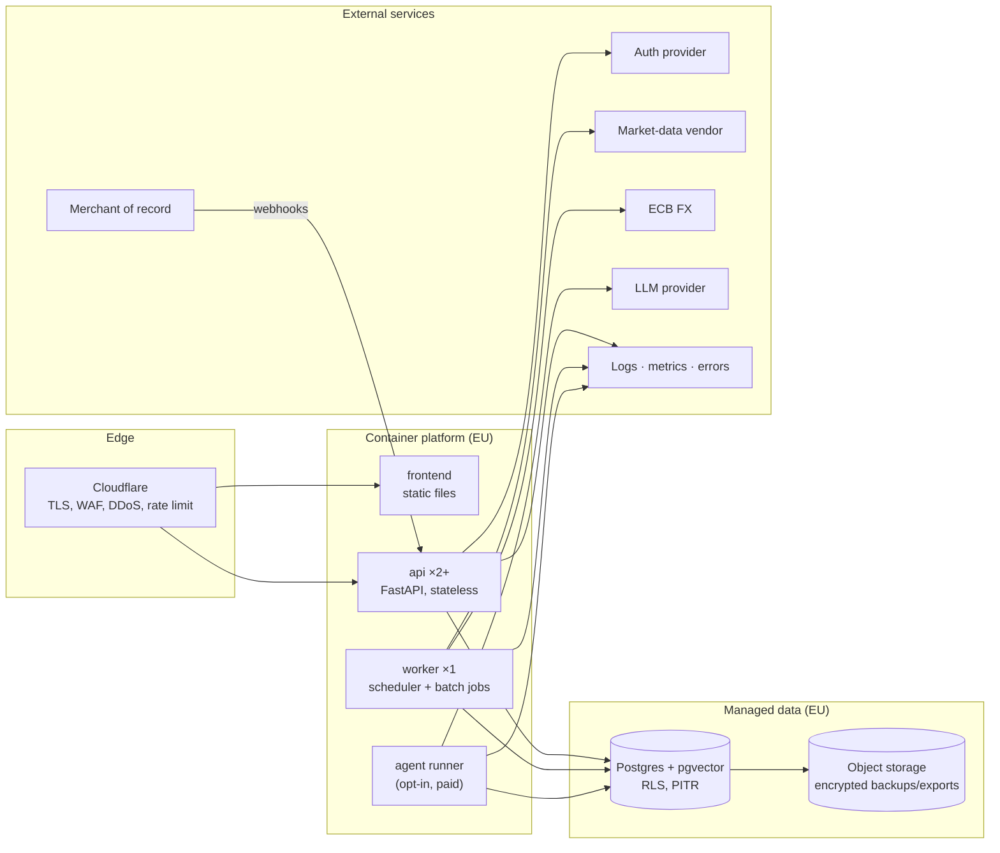
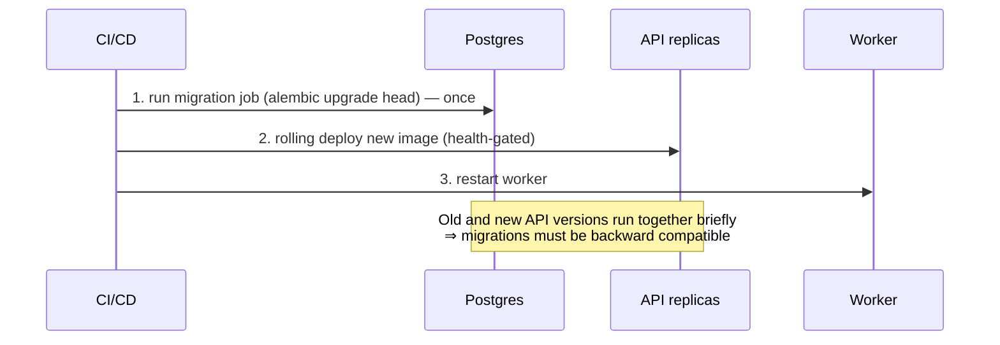

# 01 — Production architecture

## 1. The problem

Today the whole system is `docker compose up` on one machine: one Postgres,
one API process that also runs migrations and a scheduler, one local LLM, one
user. That is a perfectly good *development* shape. It fails in production in
specific, predictable ways:

| Today | Fails because |
|-------|---------------|
| `lifespan` runs `alembic upgrade head` on every boot (`backend/app/main.py`) | Two replicas start at once and race on the migration; a bad migration takes the whole API down with it |
| `BackgroundScheduler` inside the API process (`app/adapters/scheduler.py`) | N replicas ⇒ every job runs N times (duplicate snapshots, duplicate API calls, rate-limit bans) |
| API on `:8000`, CORS `localhost` | No TLS, no WAF, no real origin policy |
| Secrets in `backend/.env` | Files get copied, committed, leaked into logs |
| IBKR adapter talks to a TWS socket on the host | Impossible in a hosted service |
| One Postgres in a Docker volume | No backups, no point-in-time recovery, no failover |

The architectural job is to fix those *without* rewriting the domain — the
hexagonal layout (`domain/ports/application/adapters/api`) was built for
exactly this: only adapters and wiring change.

## 2. Options

**Deployment shape**

| Option | Pros | Cons |
|--------|------|------|
| A. One VPS, Docker Compose | Cheapest; you already have it | You own patching, backups, uptime, TLS; single point of failure |
| B. Managed containers + managed Postgres (EU) | Backups/PITR/patching handled; easy horizontal scale | Costs more; some lock-in |
| C. Kubernetes | Max flexibility | Operational overhead far beyond a solo project |

**Process model**: monolith API + separate worker (recommended) vs microservices
(unjustified at this size) vs everything in one process (today).

## 3. Decision and why

**B, with a monolith split into three process types sharing one codebase:**



**Why each choice**

- **Stateless API replicas.** Any replica can serve any request; sessions live
  in the database/provider, not in memory. This is what lets you deploy
  without downtime and survive one replica dying.
- **Separate worker.** Scheduled jobs (`refresh_market_data`, `build_snapshots`,
  `resolve_assets`) move to a worker entrypoint. One instance, plus a Postgres
  advisory lock so an accidental second instance is harmless.
- **Migrations as a release step**, not at boot. See "Expand/contract" below.
- **Managed Postgres with point-in-time recovery.** The database is the one
  component whose loss ends the business. Pay someone else to do backups.
- **Cloudflare (or equivalent) in front.** TLS, a WAF, bot/DoS absorption and
  coarse rate limiting for a few € a month. Confirm its data-processing terms
  in `05`.
- **Agents as an isolated, optional process.** AI is opt-in and paid
  (decision Q5); isolating it means its cost, failures and secrets cannot take
  down the core product.

## 4. In this repo

### 4.1 Splitting API from worker

Today (`backend/app/main.py`):

```python
scheduler = build_scheduler()

@asynccontextmanager
async def lifespan(app: FastAPI):
    _run_migrations()          # ← race with N replicas
    _configure_logging()
    gap_fill_snapshots_on_startup()
    scheduler.start()          # ← N copies of every job
    yield
    scheduler.shutdown(wait=False)
```

Target:

```python
# app/main.py — API only
@asynccontextmanager
async def lifespan(app: FastAPI):
    _configure_logging()
    yield                       # no migrations, no scheduler

# app/worker.py — one instance
def main() -> None:
    _configure_logging()
    scheduler = build_scheduler()          # same function, new home
    with advisory_lock("scheduler"):       # pg_try_advisory_lock; exit if not acquired
        gap_fill_snapshots_on_startup()
        scheduler.start()
        block_forever()
```



### 4.2 Expand / contract migrations

Because old and new code overlap during a rolling deploy, a breaking schema
change is done in separate releases:

| Release | Step | Example: add `user_id` to `accounts` |
|---------|------|-------------------------------------|
| 1 | **Expand** — add nullable column, new code writes both | `ALTER TABLE accounts ADD COLUMN user_id uuid` |
| 2 | **Backfill** — fill existing rows in batches | `UPDATE … WHERE user_id IS NULL` |
| 3 | **Contract** — enforce | `SET NOT NULL`, add FK, enable RLS |

Your own data is not a concern (production starts empty, Q10), but this habit
matters from the second release onward.

### 4.3 Configuration and secrets

`backend/app/config.py` reads environment variables. Keep that; change *where
they come from*:

- Non-secret config → plain env in the platform.
- Secrets (DB password, provider keys, webhook signing secrets) → the
  platform's secrets manager, injected as env at start; never in the image,
  never in git, never logged.
- Add `APP_ENV=production|staging|dev` and **fail fast at startup** if
  production-forbidden settings are on (e.g. `MARKET_DATA_PROVIDER=yfinance`,
  `LOCAL_BROKER_SYNC_ENABLED=true`, wildcard CORS).

```python
# app/config.py (sketch)
@model_validator(mode="after")
def _production_guards(self):
    if self.app_env == "production":
        assert self.market_data_provider != "yfinance", "yfinance is dev-only (ADR 0006)"
        assert not self.local_broker_sync_enabled, "live IBKR sync is local-only (ADR 0003)"
        assert "*" not in self.cors_origins
    return self
```

### 4.4 What moves, what stays

| Component | Change |
|-----------|--------|
| `domain/`, `ports/`, most `application/` | Unchanged (user is passed through the session/identity, not business logic) |
| `adapters/persistence/session.py` | Becomes identity-aware (see 02) |
| `adapters/market_data/yfinance_*` | Dev only; production adapter + ECB FX (see 06) |
| `adapters/brokers/ibkr.py`, `routes/sync.py` | Disabled in production |
| `adapters/scheduler.py` | Moves to worker; iterates users |
| `ai/` | Per-user MCP subprocess identity (see 07) |
| `docker-compose.yml` | Stays for local dev; production uses platform manifests |
| `frontend` | OIDC/BFF login flow, 401 handling, settings/export/delete pages |

## 5. What goes wrong in production

- **"It worked on my machine" migrations.** A migration that locks a big table
  (`ALTER TABLE … SET NOT NULL` on millions of rows) blocks every request.
  Practice on a copy; use `NOT VALID` + `VALIDATE CONSTRAINT` for big tables.
- **Health checks that lie.** `/health` returning 200 while the DB is
  unreachable keeps a broken replica in rotation. Split **liveness** (process
  is up) from **readiness** (can reach DB).
- **Thundering herd on boot.** All replicas hit the market-data vendor at
  start. Jobs belong to the worker, not the API.
- **Time zones.** Store UTC, convert at the edge; the snapshot job's
  `SNAPSHOT_BUILD_HOUR_UTC` already follows this — keep it.
- **Config drift between staging and production.** One image, different
  config; never "build for production".
- **Unbounded connection counts.** N replicas × pool size can exceed
  Postgres `max_connections`. Use a pooler (PgBouncer) in transaction mode —
  and read the RLS note on pooling in 02.

## 6. Checklist

- [ ] API has no scheduler and no boot-time migration
- [ ] Worker runs exactly one scheduler; advisory lock proven by a test
- [ ] Migrations run as a separate release job; expand/contract documented
- [ ] Startup guards refuse dev-only settings in production
- [ ] Secrets only from the secrets manager; `.env` never reaches an image
- [ ] Readiness and liveness endpoints distinct
- [ ] Same image deployed to staging and production
