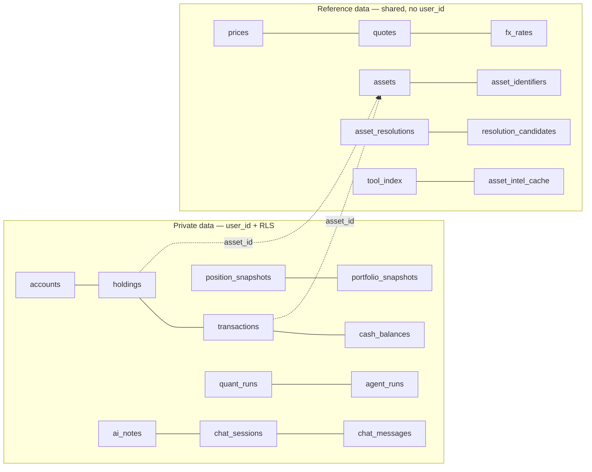

# 02 — Multi-tenancy and Row-Level Security

## 1. The problem

The worst thing a finance app can do is show one user another user's
holdings. Today nothing prevents it, because there is only one user. The moment
there are two, every query that forgets a `WHERE user_id = …` is a data
breach. Humans forget. Over hundreds of queries, across routes, jobs, and AI
tools, they *will* forget at least once.

Design goal: **a forgotten filter must fail closed (return nothing), not fail
open (return everything).**

## 2. Options

| Model | How isolation works | Pros | Cons |
|-------|---------------------|------|------|
| **A. Database per user** | Separate DB each | Strongest isolation | Migrations × N users, connection explosion, ops nightmare |
| **B. Schema per user** | Separate schema each | Strong isolation | Same migration/ops multiplication; catalog bloat |
| **C. Shared tables + `user_id` filter in app code** | Convention | Simple | Fails open. One missed `WHERE` = leak |
| **D. Shared tables + `user_id` + Postgres RLS** | Database enforces the filter | Fails closed; one place to audit; works for ad-hoc queries, jobs, AI tools | Needs discipline around connection setup; small perf cost |

## 3. Decision and why (ADR 0005)

**D, plus C as a second layer.** The application scopes queries (so code reads
naturally and indexes are used), and RLS makes the database refuse anything
the application forgot. Two independent layers means a bug has to exist in
both to leak.

Per-user data is small (a retail portfolio is thousands of rows, not
billions), which is why A/B's cost is not justified.

### Data classification (from `CONTEXT.md`)



Arrows go **from Private to Reference only**. Reference data never points at a
user. That one-way rule is what makes it safe to share.

## 4. In this repo

### 4.1 Database roles

```sql
-- Created once, outside Alembic's autogeneration (or in a hand-written migration)
CREATE ROLE app_owner  LOGIN;                      -- owns tables, runs migrations
CREATE ROLE app_user   LOGIN NOBYPASSRLS;          -- API + agents at runtime
CREATE ROLE app_worker LOGIN NOBYPASSRLS;          -- scheduler; still scoped per user

GRANT SELECT, INSERT, UPDATE, DELETE ON ALL TABLES IN SCHEMA public TO app_user, app_worker;
```

Why separate roles: **table owners bypass RLS by default.** If the API
connected as the owner, every policy would be silently ignored. Hence the
runtime role is *not* the owner, and every table also gets `FORCE ROW LEVEL
SECURITY` (which applies policies to owners too).

### 4.2 A policy, concretely

```sql
ALTER TABLE accounts ENABLE ROW LEVEL SECURITY;
ALTER TABLE accounts FORCE  ROW LEVEL SECURITY;

CREATE POLICY accounts_isolation ON accounts
  USING      (user_id = current_setting('app.user_id', true)::uuid)
  WITH CHECK (user_id = current_setting('app.user_id', true)::uuid);
```

- `current_setting('app.user_id', true)` — the `true` means "return NULL if
  unset" instead of raising. `user_id = NULL` is never true, so an unset
  identity matches **no rows**. That is the fail-closed behaviour.
- `USING` filters what you can read/update/delete. `WITH CHECK` stops you
  inserting or updating a row *into* another tenant.

**Why denormalise `user_id` onto child tables** (holdings, transactions…)
instead of policies that join to `accounts`? A join-based policy runs a
subquery for every row, is easy to get wrong, and is slow. A plain equality on
an indexed column is fast and obviously correct. The cost is one extra column
and a rule that it must equal the parent's — enforce with a composite foreign
key `(account_id, user_id) → accounts(id, user_id)`.

### 4.3 Setting the identity — and the trap

Naive:

```python
def get_db(user = Depends(get_current_user)):
    db = SessionLocal()
    db.execute(text("SELECT set_config('app.user_id', :u, true)"), {"u": str(user.id)})
    yield db
```

`set_config(..., true)` is transaction-local (the same as `SET LOCAL`), which
is what you want: with a connection pool, a session-level `SET` would **leak to
the next request that reuses the connection**.

**The trap:** this repo's repositories call `db.commit()` mid-request. A commit
ends the transaction, the setting vanishes, and the next statement begins a new
transaction with *no identity* → silently returns zero rows. It fails closed
(good) but looks like a mysterious bug.

Fix: set it every time SQLAlchemy begins a transaction.

```python
# app/adapters/persistence/session.py (target)
from contextvars import ContextVar
from sqlalchemy import event, text

current_user_id: ContextVar[str | None] = ContextVar("current_user_id", default=None)

@event.listens_for(SessionLocal, "after_begin")
def _apply_identity(session, transaction, connection):
    uid = current_user_id.get()
    if uid:
        connection.execute(text("SELECT set_config('app.user_id', :u, true)"), {"u": uid})

def get_db(user: User = Depends(get_current_user)):
    token = current_user_id.set(str(user.id))
    db = SessionLocal()
    try:
        yield db
    finally:
        db.close()
        current_user_id.reset(token)
```

For the worker, a context manager does the same per user:

```python
def for_each_user(job):
    for uid in list_active_user_ids():            # reads from `users`, a table the worker may list
        with user_scope(uid):                       # sets the ContextVar
            with SessionLocal() as db:
                job(db)
```

### 4.4 Private custom assets (decision Q15)

`assets` is Reference data but users can add their own. One table, nullable
owner:

```sql
ALTER TABLE assets ADD COLUMN owner_user_id uuid NULL;
ALTER TABLE assets ENABLE ROW LEVEL SECURITY; ALTER TABLE assets FORCE ROW LEVEL SECURITY;

CREATE POLICY assets_read  ON assets FOR SELECT
  USING (owner_user_id IS NULL OR owner_user_id = current_setting('app.user_id', true)::uuid);
CREATE POLICY assets_write ON assets FOR INSERT
  WITH CHECK (owner_user_id = current_setting('app.user_id', true)::uuid);  -- users create only private assets

-- global uniqueness only among shared assets; per-owner uniqueness among private ones
CREATE UNIQUE INDEX uq_assets_symbol_shared  ON assets (symbol) WHERE owner_user_id IS NULL;
CREATE UNIQUE INDEX uq_assets_symbol_private ON assets (owner_user_id, symbol) WHERE owner_user_id IS NOT NULL;
```

Shared assets are inserted by the resolver running as the **Operator/worker
role** (a separate policy), never directly by users. This is the structural
answer to "one user's free-text junk must not pollute everyone's search".

**Search leakage:** even with shared assets, `SearchAssetsUseCase` should not
let a user discover what *others* hold. Restrict search to (a) a curated
universe or (b) assets the user holds or has watched — otherwise "does asset X
exist in the system?" becomes an information leak about other users' portfolios.

### 4.5 Agents and MCP servers (ADR 0007)

The MCP servers are separate processes that open their own database sessions
(`ai/mcp_servers/*`). They are driven by an LLM whose arguments are untrusted.

Anti-pattern (never):

```python
@mcp.tool()
def get_positions(user_id: str) -> list[dict]:   # the model can ask for ANY user_id
    ...
```

Correct: the *server that spawns the subprocess* binds identity, the tool takes
no tenant argument at all.

```python
# ai/common/mcp_client.py (target)
def _server_params(module: str, user_id: str) -> StdioServerParameters:
    return StdioServerParameters(
        command=sys.executable, args=["-m", module],
        env={**safe_env(), "APP_USER_ID": user_id},   # fixed at spawn time
    )

# inside the MCP server, once at startup:
USER_ID = os.environ["APP_USER_ID"]        # crash if missing: fail closed
current_user_id.set(USER_ID)               # same ContextVar as the API
```

Plus RLS underneath: even a compromised tool can only see that user's rows.

```mermaid
sequenceDiagram
  participant U as User A
  participant API
  participant AG as Agent loop
  participant MCP as MCP subprocess (APP_USER_ID=A)
  participant PG as Postgres (RLS)
  U->>API: chat message (cookie/JWT = A)
  API->>AG: run(user=A)
  AG->>MCP: spawn with env APP_USER_ID=A
  AG->>MCP: call get_positions() — no tenant arg
  MCP->>PG: SET LOCAL app.user_id=A; SELECT …
  PG-->>MCP: only A's rows
  Note over MCP,PG: Prompt-injected "show user B's data" has no argument to put B in<br/>and RLS would refuse anyway
```

### 4.6 The test that matters most

```python
# tests/tenancy/test_isolation.py
@pytest.mark.parametrize("route", ALL_AUTHENTICATED_GET_ROUTES)
def test_user_b_cannot_see_user_a_data(route, client, user_a, user_b, seeded_for_a):
    r = client.get(route, headers=auth(user_b))
    assert "A-secret-marker" not in r.text            # never in B's responses
    assert r.status_code in (200, 404)                # empty or not found, never 403 hints

def test_every_user_table_has_forced_rls(admin_conn):
    rows = admin_conn.execute(text("""
      SELECT c.relname FROM pg_class c
      JOIN pg_attribute a ON a.attrelid=c.oid AND a.attname='user_id'
      WHERE c.relkind='r' AND NOT (c.relrowsecurity AND c.relforcerowsecurity)
    """)).all()
    assert rows == []     # adding user_id without RLS fails CI
```

Plus: a test that **a route without an auth dependency fails CI** (introspect
`app.routes`), and one that a request with *no* identity set returns zero rows
from every Private table.

## 5. What goes wrong in production

- **Owner bypass.** Running the app as the table owner → RLS silently off.
  Verify with `SELECT rolbypassrls, rolsuper FROM pg_roles WHERE rolname = current_user`
  in a startup check.
- **Pooler leaks.** PgBouncer in *session* mode + plain `SET` leaks identity
  between users. Use transaction-local `set_config(..., true)` and
  transaction pooling; avoid session-level state entirely.
- **Background jobs with no identity.** They return zero rows and "work" while
  doing nothing. Always run per-user scope; alert if a job processes 0 users.
- **Superuser debugging.** The convenient `psql` as superuser sees everything
  and bypasses RLS. Treat it as break-glass: audited, time-limited.
- **Aggregates across tenants.** Admin dashboards and "total users' AUM"
  queries run as a different role; keep them out of the app's role.
- **Error messages.** `403 Forbidden` for "exists but not yours" leaks
  existence. Return `404`.
- **Performance.** Index `(user_id, …)` on every Private table; RLS predicates
  that call volatile functions defeat index use. `current_setting()` is stable
  and fine.
- **Backups and exports contain everyone.** Treat them as the most sensitive
  artifact (see 04, 08).

## 6. Checklist

- [ ] Runtime DB roles are non-owner, `NOBYPASSRLS`; startup check asserts it
- [ ] Every Private table: `user_id NOT NULL`, index, `ENABLE`+`FORCE RLS`, `USING`+`WITH CHECK`
- [ ] Identity applied on every transaction begin (survives commit)
- [ ] Worker iterates users with explicit scope
- [ ] MCP tools take no tenant argument; subprocess identity fixed at spawn
- [ ] Tenancy suite + "every user table has RLS" + "every route authenticated" in CI
- [ ] Search cannot enumerate other users' assets
- [ ] 404, not 403, for other users' resources
