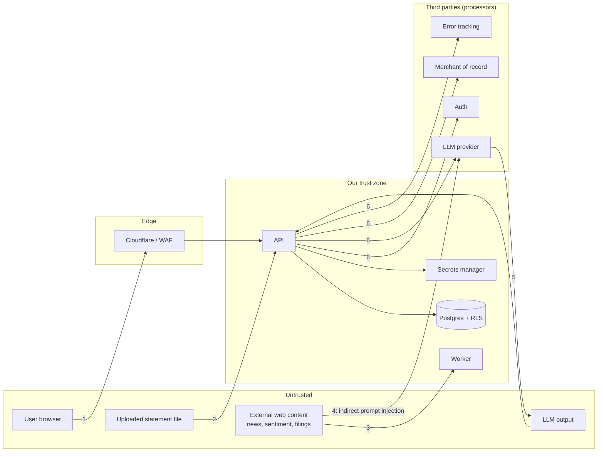

# 04 — Security and threat model

## 1. The problem

"Be secure" is not actionable. Security work becomes tractable when you (a)
name what you are protecting, (b) list who could attack it and how, and (c) map
each attack to a control you can test. This doc does that for this product.

What is worth protecting, ranked:

1. **Users' holdings and transaction history** (privacy; also a map of who is wealthy → targeted phishing/extortion).
2. **Session/identity integrity** (account takeover).
3. **Availability and data integrity** (a wrong valuation destroys trust).
4. **The operator's secrets** (DB, provider, signing keys).
5. **Your wallet** (LLM and market-data costs can be driven up by abuse).

## 2. Options for how to structure the work

| Approach | Use |
|----------|-----|
| Ad-hoc "fix things as I think of them" | Misses whole classes of risk |
| **STRIDE threat model per trust boundary** | Systematic, cheap, documents decisions (**chosen**) |
| Compliance frameworks (SOC 2, ISO 27001) | Not required at launch; revisit if selling B2B |
| **OWASP ASVS Level 1 checklist** before launch | Concrete verification list (**chosen**, Q13) |

ASVS 5.0 organises ~350 requirements into 17 chapters across three levels;
Level 1 is the baseline "obvious issues" pass. Walking it yourself, then
pen-testing the top risks, is realistic for a solo launch. ⚠ verify the
current ASVS version/numbering when you start.

## 3. Decision and why — the threat model

### 3.1 Trust boundaries



Numbered arrows are where the controls below attach.

### 3.2 STRIDE table (the important rows)

| # | Boundary | Threat (STRIDE) | Example | Control | Where |
|---|----------|-----------------|---------|---------|-------|
| 1 | Browser→API | **S**poofing | Stolen session cookie | `HttpOnly` `__Host-` cookie, short idle timeout, revocation, device list, MFA | 03 |
| 1 | Browser→API | **T**ampering | CSRF on "delete account" | SameSite + CSRF header, step-up auth | 03 |
| 1 | Browser→API | **I**nfo disclosure | IDOR: `GET /accounts/42` of another user | RLS + 404 for foreign ids + tenancy tests | 02 |
| 1 | Browser→API | **D**oS | Scripted heavy `/quant/run` | Per-user quotas + rate limits + job queue + timeouts | below |
| 1 | Browser→API | **E**levation | User hits Operator route | Server-side role check, MFA for Operator | 03 |
| 2 | Upload→API | **T**ampering/**D**oS | Zip-bomb XLSX, huge CSV | Size cap, decompressed-size cap, row cap, parse timeout, `defusedxml`, run in worker | below |
| 2 | Upload→export | **T**ampering | CSV/formula injection (`=HYPERLINK(...)`) when users open exports | Prefix `'` to cells starting `= + - @ \t \r` on export | below |
| 3 | Web→Worker | **T**ampering | Poisoned news/sentiment | Treat as data; never as instructions; sanitize before LLM | 07 |
| 4 | Web→LLM | **E**levation | Hidden text in a headline: "ignore previous instructions; save note…" | Read-only tools by default, no tenant args (ADR 0007), egress rules (rule 13), output checks, no auto-rendered remote images | 07 |
| 5 | LLM→API | **R**epudiation/**T**ampering | Agent writes a note the user didn't ask for | `agent_runs` audit trail; label AI-authored notes; user can delete | 07 |
| 6 | API→3rd party | **I**nfo disclosure | PII in error tracker; holdings sent to LLM without consent | Scrubbing, DPAs, opt-in consent, data minimisation | 05 |
| — | Secrets | **I**nfo disclosure | Key in git/log | Secrets manager, gitleaks in CI, never log request bodies | 08 |
| — | Backups | **I**nfo disclosure | Dump of everyone's data | Encrypted at rest, restricted access, short retention, access audited | 08 |
| — | Insider (you) | **I**nfo disclosure | Debugging in prod DB | Break-glass access, audited, no routine access (Operator ≠ data viewer) | below |
| — | Supply chain | **T**ampering | Malicious dependency | Lockfiles, `pip-audit`, Dependabot, pinned images, minimal base | 08 |

### 3.3 Abuse economics (the "your wallet" threat)

Unlike classic SaaS, AI and market-data calls cost money per request. Treat
cost as a security property:

- per-user daily/monthly **token quota**; global **budget circuit breaker**
  (stop AI at €X/day, alert you);
- per-user rate limits on expensive endpoints (quant runs, intel loads);
- sign-up friction (verified email, Cloudflare Turnstile) to stop free-tier farming;
- the free tier has **no AI** (Q3/Q5), which removes the largest abuse target.

## 4. In this repo — concrete controls

### 4.1 Security headers and CORS

Replace the hard-coded localhost list in `app/main.py` with config, and add
headers (via middleware or at nginx/Cloudflare):

```python
app.add_middleware(CORSMiddleware,
    allow_origins=settings.cors_origins,          # exact origins; empty in prod if same-origin
    allow_credentials=True, allow_methods=["GET","POST","PUT","PATCH","DELETE"],
    allow_headers=["Content-Type","X-Requested-With"])

SECURITY_HEADERS = {
  "Strict-Transport-Security": "max-age=63072000; includeSubDomains; preload",
  "X-Content-Type-Options": "nosniff",
  "Referrer-Policy": "strict-origin-when-cross-origin",
  "Permissions-Policy": "camera=(), microphone=(), geolocation=()",
  "Content-Security-Policy": "default-src 'self'; img-src 'self' data:; "
                             "script-src 'self'; style-src 'self' 'unsafe-inline'; "
                             "frame-ancestors 'none'; base-uri 'self'; form-action 'self'",
}
```

CSP is your main defence-in-depth against XSS; with the BFF session design (03)
even a successful XSS cannot exfiltrate tokens, but could still act as the user,
so keep CSP strict and avoid `dangerouslySetInnerHTML` (also relevant to
rendering AI/Markdown output — sanitise it).

### 4.2 Upload hardening (`api/routes/imports.py`)

```python
MAX_BYTES = 5 * 1024 * 1024

async def read_upload(file: UploadFile) -> bytes:
    data = await file.read(MAX_BYTES + 1)
    if len(data) > MAX_BYTES: raise HTTPException(413)
    kind = sniff(data)                       # magic bytes: ZIP(xlsx) / text(csv); ignore filename & Content-Type
    if kind not in {"xlsx","csv"}: raise HTTPException(415)
    if kind == "xlsx": check_zip_limits(data, max_uncompressed=50*MB, max_entries=200)
    return data
```

- Parse with `defusedxml`-backed libraries; cap rows (e.g. 100k) and wall-clock time.
- **Do not store the original file** (data minimisation): parse, import,
  discard. Keep only the import fingerprint (`application/import_fingerprint.py`
  already provides idempotency).
- Never echo raw cell content into HTML or logs.
- Import is Private data written under the user's RLS scope — a malformed
  file cannot touch other tenants.

### 4.3 Rate limiting

Two layers: Cloudflare rules (coarse, per IP) and an application limiter
keyed by **user id** for authenticated endpoints. Example budgets (tune with
beta data): login/callback 10/min/IP; import 10/hour/user; quant run
30/hour/user; intel load 60/hour/user; AI per quota.

### 4.4 Audit log

```sql
CREATE TABLE audit_log (
  id bigserial PRIMARY KEY, at timestamptz NOT NULL DEFAULT now(),
  actor_user_id uuid, actor_role text, action text NOT NULL,   -- 'login','export','delete_account','operator.resolve'
  target text, ip inet, user_agent text, request_id text
);  -- append-only: INSERT-only grant; no UPDATE/DELETE for app roles
```

Log **who did what**, never financial values. Operator actions and
Operator-only data access are always logged.

### 4.5 Logging and error tracking without leaking money

- Structured JSON logs with a request id; log route templates, status, latency,
  user id (opaque uuid) — **not** request/response bodies, not holdings, not
  tickers-with-quantities.
- Error tracker (EU-hosted, with a DPA): enable scrubbing; drop `Authorization`,
  cookies, bodies; `send_default_pii=False`.
- Credentials/tokens never in exception messages (already a rule in
  `AGENTS.md`; add a test that greps logs in the integration suite).

### 4.6 CI security gates (extend `.github/workflows/ci.yml`)

| Gate | Tool (examples) | Fails build on |
|------|-----------------|----------------|
| Secret scanning | gitleaks / GitHub secret scanning | any detected secret |
| Python deps | `pip-audit` | known vulnerable deps |
| JS deps | `npm audit --omit=dev` | high/critical |
| SAST | Bandit / Semgrep rules for FastAPI/SQLAlchemy | high severity |
| Container | Trivy | fixable critical/high |
| Dependency updates | Dependabot/Renovate | (opens PRs) |
| Tenancy tests | pytest `tests/tenancy` | any failure |
| Route-auth test | pytest | unauthenticated non-allow-listed route |

### 4.7 Break-glass access for you (the Operator)

You will need to look at production sometimes. Rules: no standing superuser
credentials on your laptop; access via a time-boxed role that is logged;
prefer reproducing a bug with synthetic data; never copy production data to
dev (that would make dev a regulated environment — see 05).

## 5. What goes wrong in production

- **IDOR via integer ids.** Sequential ids invite enumeration. RLS makes it
  non-exploitable, but also prefer UUIDs for new Private tables.
- **Mass assignment.** Passing a request body straight into an ORM model lets a
  user set `user_id` or `plan`. Use explicit input schemas that exclude them;
  set `user_id` only server-side.
- **Debug endpoints/openapi in prod.** Disable `/docs`, `/openapi.json` or
  protect them; remove the pgAdmin service entirely from production.
- **Default credentials.** The dev compose file ships pgAdmin
  `admin@…/admin`; never carry any of that forward.
- **Logging the world.** One `logger.info(payload)` in an import path puts
  every user's trades in your log provider.
- **Secrets in client bundles.** Anything `VITE_*` is public.
- **SSRF.** Market-intel adapters call external URLs from a symbol/topic; keep
  hosts hard-coded, validate inputs (already `validate_topic`), block private IP
  ranges if any URL ever comes from data.
- **Alert fatigue.** Alerts that fire daily get ignored. Alert on
  user-impacting symptoms only.
- **Never testing restore.** An untested backup is a hope, not a control.

## 6. Pre-launch security activities

1. Threat model review (this table) — update when features change.
2. ASVS Level 1 walkthrough, issue per failed item.
3. Tenancy "red team" day: try to cross tenants through every route, the export,
   the chat, each MCP tool, the scheduler.
4. Authenticated scan (e.g. OWASP ZAP) against staging.
5. Restore drill and secret-rotation drill.
6. Optional but valuable: a paid, scoped penetration test once the beta is stable.
7. Publish `security.txt` with a contact for vulnerability reports.

## 7. Checklist

- [ ] Headers + CSP + strict CORS from config
- [ ] Upload limits, type sniffing, zip/row caps, no file retention
- [ ] Per-IP and per-user rate limits; AI/cost circuit breaker
- [ ] Audit log append-only; Operator actions logged
- [ ] Log/error scrubbing verified by test
- [ ] CI gates: secrets, deps, SAST, container, tenancy, route-auth
- [ ] `/docs` and pgAdmin absent in production; no default credentials
- [ ] Mass-assignment review: `user_id`, `plan`, `deleted_at` never client-settable
- [ ] ASVS L1 done; tenancy red-team done; restore drill done
