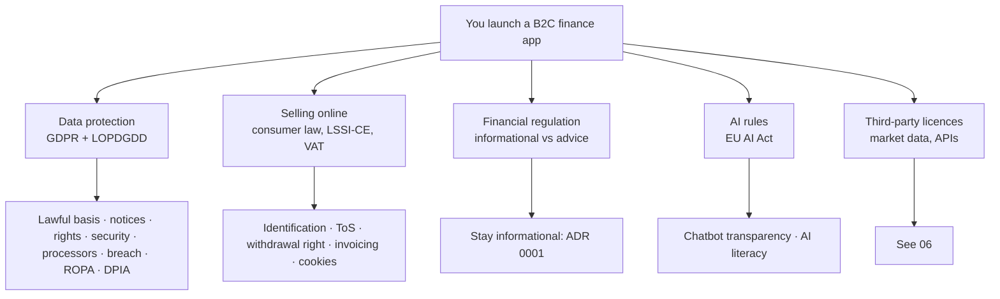
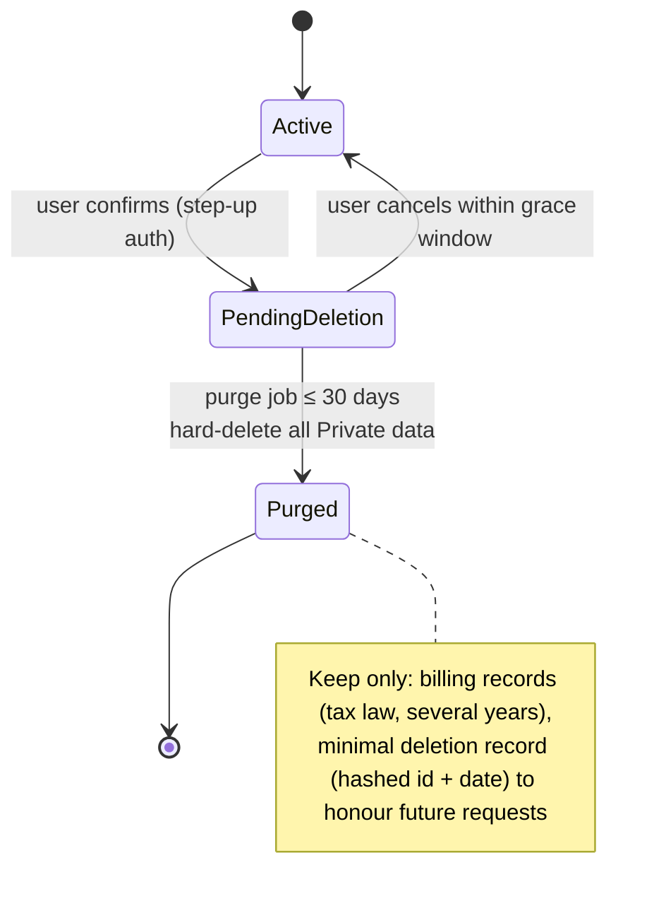

# 05 — GDPR and legal (Spain / EU)

> **Not legal advice.** This is a map of what to address and typical
> practice, from public guidance (AEPD, EU institutions) as of October 2026.
> Items marked ⚠ verify depend on dates or interpretations that move. Budget
> for a lawyer to review the ToS, Privacy Policy and disclaimer before launch
> (Q14); an hour or two of a Spanish data-protection / digital-services
> lawyer is cheap compared with the cost of getting these wrong.

## 1. The problem

Once you hold other people's financial data you are a **data controller** under
the GDPR (and Spain's LOPDGDD). That creates obligations whether or not you
ever get a complaint: lawful basis, transparency, security, user rights,
processor contracts, breach reporting, records. Separately, consumer, e-commerce
and financial-services laws apply to *selling* and to *what you may say about
investments*.



## 2. Options (and the one we take for each)

| Question | Options | Choice |
|----------|---------|--------|
| Market | EU-only vs worldwide | **EU/EEA-only** (ADR 0002): avoids CCPA/US state laws, transfer complexity |
| Hosting | EU vs anywhere | **EU region**, EU-resident processors where possible |
| Lawful basis for core service | Contract vs consent | **Contract** (Art. 6(1)(b)): needed to provide what the user asked for |
| Lawful basis for AI processing by a third-party LLM | Contract / legitimate interest / consent | **Explicit opt-in consent** (Q12): easiest to defend and to withdraw |
| Analytics | Tracking analytics vs none vs cookieless | **Cookieless / none** to avoid a consent banner (see §4.6) |
| Age | 14+ (Spain's age of digital consent) vs 18+ | **18+** in the ToS: avoids minors' special regime |
| DPO | Appoint vs not | Likely **not required** for a small service without large-scale systematic monitoring ⚠ verify; document the reasoning |

## 3. Decision and why — obligations map

### 3.1 Who is who (roles)

```mermaid
flowchart LR
  U[User<br/>data subject] -- personal & financial data --> C[You<br/>CONTROLLER]
  C -- DPA --> P1[Hosting + managed DB]
  C -- DPA --> P2[Auth provider]
  C -- DPA --> P3[Error tracking / logs]
  C -- DPA --> P4[Email sender]
  C -- DPA, opt-in only --> P5[LLM provider]
  C -- data about payment --> M[Merchant of record<br/>(independent controller for payment data)]
  C -- public prices, no user data --> V[Market-data vendor]
```

Every **processor** needs a Data Processing Agreement (usually accept the
vendor's standard DPA online) and must be listed in your privacy policy and
ROPA. The market-data vendor receives **no user data** (only public symbols) —
keep it that way, it simplifies everything (and matches the egress rule in
`AGENTS.md`).

### 3.2 Principles → what you build

| GDPR principle | In this product |
|----------------|-----------------|
| Lawfulness, fairness, transparency | Privacy policy in plain language; consent screens for AI; versioned ToS acceptance recorded |
| Purpose limitation | Holdings used to show the portfolio; **not** for marketing, not sold, not used to train models |
| Data minimisation | Do not store uploaded files; no unneeded fields; no ID documents; no broker credentials (ADR 0003) |
| Accuracy | Users can edit/delete transactions; import is idempotent |
| Storage limitation | Deletion rules below; log retention ≤ 30–90 days |
| Integrity & confidentiality (Art. 32) | Encryption in transit/at rest, RLS, access control — doc 04 |
| Accountability | ROPA, DPIA, DPAs, breach log, this documentation |

### 3.3 User rights → features

| Right | Feature | Deadline |
|-------|---------|----------|
| Access / portability (Art. 15, 20) | Self-serve **export** (JSON + CSV) in Settings | immediate (self-serve); 1 month if by email |
| Rectification (16) | Edit transactions, accounts, custom assets | n/a |
| Erasure (17) | **Delete my account** button | immediate soft-delete; hard purge ≤ 30 days |
| Restriction / objection (18, 21) | Opt-out of AI; email request | 1 month |
| Withdraw consent (7) | Toggle AI consent off → stop sending data; purge AI chat history on request | immediate |

The one-month response window (extendable in complex cases) applies to
requests made outside the self-serve flows; keep a mailbox (`privacy@`) and a
log of requests.

### 3.4 Retention and deletion (decision Q11)



- Hard delete = `DELETE … WHERE user_id = …` across all Private tables (FK `ON DELETE CASCADE` from `users`), then remove from the auth provider and merchant-of-record customer record where allowed.
- **Backups** still contain the data until they age out: document the backup retention (e.g. 30 days), and a restore procedure that **re-applies deletions** after any restore.
- **Test it:** an integration test creates a user with data in every table, deletes, and asserts zero rows remain (the schema-introspection test from 02 helps find forgotten tables).
- Logs must not contain financial values so they do not need per-user deletion.

### 3.5 Breach response (Art. 33/34)

Notify the AEPD **within 72 hours of becoming aware** of a breach likely to
risk individuals' rights (via the AEPD's online notification form; staged
notification is allowed if details are incomplete), and notify affected users
without undue delay if the risk is high. Prepare *before* you need it:

1. Runbook: detect → contain → assess → decide → notify → learn.
2. Breach register (even for non-notifiable incidents).
3. Contact details ready; template messages drafted.
4. Know what a leak of *this* data looks like: portfolios + email = phishing fuel.

### 3.6 Records and assessments

| Document | Required? | Content |
|----------|-----------|---------|
| **ROPA** (Art. 30) | Smaller orgs are partly exempt, but exemption is lost for non-occasional processing — **keep one** | processing activities, purposes, categories, recipients, transfers, retention, security |
| **DPIA** (Art. 35) | Probably not mandatory, but doing a short one is cheap and good evidence ⚠ verify | risks of holding financial portfolios, AI processing, mitigations |
| **LIA / consent records** | For consents | who, what text version, when |
| **DPA register** | Yes | vendor, DPA link, region, transfer mechanism |
| **Breach register** | Yes | incident log |

International transfers: prefer EU-resident processors. If a vendor stores
data outside the EEA, confirm the transfer mechanism (adequacy decision or SCCs;
for US vendors check participation in the EU-US Data Privacy Framework) and
document it. Under ADR 0002 aim for none.

## 4. In this repo — the legal pack and the features it needs

### 4.1 Documents to draft (`docs/legal/` — drafts, reviewed by a lawyer)

| Document | Notes specific to this product |
|----------|--------------------------------|
| Terms of Service | 18+; service description (tracker/analytics, **not advice**); data accuracy disclaimer (prices delayed, from third parties, may be wrong); acceptable use; subscription terms; liability limits within consumer-law limits (consumer rights can't be waived); governing law/venue (Spain/EU consumer protections apply regardless) |
| Privacy Policy | controller identity; what data (email, holdings, transactions, usage); purposes + bases; processors & regions; retention; rights & how; AI processing and consent; contact; AEPD complaint right |
| Financial disclaimer | "Informational use only; not investment, tax or legal advice; past performance…; models are simulations" — shown at signup, on Quant Lab, and in the assistant |
| Cookie notice | Short if only strictly necessary cookies (session) — see 4.6 |
| Subprocessor list | public page, updated on change |
| DPIA, ROPA, breach runbook | internal |
| Security page + `security.txt` | trust signal |

### 4.2 Spain-specific must-haves

- **LSSI-CE (Law 34/2002) identification**: the website must show your
  identity — name/business name, NIF, registered address, contact email, and
  registry data if applicable. Put it in the footer/legal page. ⚠ verify exact
  fields with your lawyer.
- **Online contracting information** before purchase: price including taxes,
  main features, how to cancel, withdrawal right.
- **Consumer withdrawal right (14 days)** for digital services: the merchant of
  record handles the mechanics; you must ensure the checkout collects the
  **express consent to start the service immediately and acknowledgement of
  losing the withdrawal right once fully performed** where applicable ⚠ verify
  with the MoR's flow.
- **Invoices / VAT:** with a merchant of record, *they* sell to the consumer
  and remit VAT; you invoice them for your payout. Keep the accounting
  consequences with your gestor/accountant.

### 4.3 Informational-use guardrails (ADR 0001)

Avoiding "investment advice/recommendation" is partly wording, partly
behaviour. Rules to encode:

- No output may say or imply "you should buy/sell/hold X", rank assets as
  "best", set price targets, or tailor a recommendation to the user's goals.
- Describing facts about the user's own portfolio ("this position is 38% of
  your portfolio") is informational; "reduce it" is advice.
- `recommend_model` in Quant Lab recommends a **statistical model for
  forecasting a series**, not an investment — rename in UI copy to avoid
  confusion (e.g. "suggested model", with explanation).
- Test it: an eval set of prompts that try to elicit advice, asserting the
  assistant declines and restates its scope (see 07).
- Show the standing disclaimer where outputs are shown.

Why this matters: personalised recommendations on financial instruments can
fall under MiFID II investment-advice rules, which require authorisation. The
safe posture for a solo founder is to stay clearly on the information side.
⚠ A short consult with a lawyer (or CNMV guidance) is advisable to confirm
your specific wording and features (forecast charts, "signals") stay on the
right side.

### 4.4 EU AI Act

Your assistant is a **conversational AI system** → a "limited-risk" case with
**transparency obligations** (Art. 50): users must be informed they are
interacting with an AI system (unless obvious). Public reporting (as of Oct
2026) says the Article 50 transparency obligations apply from **2 August 2026**,
with a grace period to **2 December 2026** for generative systems already on the
market for the *marking* of synthetic content ⚠ verify current dates and any
amendments before launch. Practical steps:

- Label the assistant clearly as AI; label AI-authored notes (`ai_notes`
  already exist — add an "AI-generated" marker in UI and export).
- Keep a short **AI-literacy** note (the Act expects providers/deployers to
  ensure staff/users have appropriate understanding) — your in-app "How the
  assistant works and its limits" page.
- Credit scoring and similar use-cases are *high-risk*; you do not do those
  (and ADR 0001 keeps it that way).
- If you build on a third-party model, you are a **deployer** (and arguably a
  provider of the combined system) — read the model provider's AI Act
  documentation.

### 4.5 Consent screen for AI (what "good" looks like)

```text
[ ] Enable the AI assistant
    When on, questions you ask and relevant parts of your portfolio
    (positions, transactions, notes) are sent to <Provider>, based in <region>,
    to generate answers. They don't use your data to train models and delete it
    after <N> days. You can turn this off any time; this stops future sending
    and you can delete your chat history in Settings.
    [Privacy policy]   [How the assistant works]
```

Store: `users.ai_consent_at`, consent text version, and withdrawal time. The
agent entry point refuses to run if consent is not currently valid (enforced in
code, not just UI).

### 4.6 Cookies and analytics (LSSI-CE art. 22.2 + AEPD guidance)

- Strictly necessary cookies (the session cookie, CSRF) need **no consent**,
  only information.
- AEPD's 2024 cookie guide treats purely anonymous, aggregate, first-party,
  EU-resident audience measurement without cross-site tracking as not requiring
  consent when its conditions are met ⚠ verify the four conditions against the
  current guide. A privacy-first analytics tool (cookieless, EU-hosted) can fit;
  otherwise **no analytics** and no banner.
- Do **not** add third-party trackers/ads/pixels — they would create a consent
  banner, transfers and a larger privacy-policy surface.

### 4.7 Data model additions

```sql
CREATE TABLE consents (
  id bigserial PRIMARY KEY, user_id uuid NOT NULL REFERENCES users(id) ON DELETE CASCADE,
  kind text NOT NULL,                 -- 'tos','privacy','ai'
  version text NOT NULL, granted_at timestamptz NOT NULL, withdrawn_at timestamptz NULL, ip inet NULL
);
CREATE TABLE dsar_requests (          -- Operator-visible, minimal
  id bigserial PRIMARY KEY, user_ref text, kind text, received_at timestamptz, closed_at timestamptz
);
```

## 5. What goes wrong in production

- **"We'll write the privacy policy later."** The policy must describe what you
  *actually* do; write it from the real data flows (this doc's tables) and update
  it per feature.
- **Silent subprocessors.** Adding a new SaaS (analytics, support desk, LLM)
  without updating the policy/DPA list.
- **Dev copies of production data.** Makes dev/laptops regulated and unsafe.
  Use synthetic data.
- **Deletion gaps.** A new table added without `user_id`/cascade survives
  deletion. CI introspection test (02) catches it.
- **AI chat logs forgotten.** `chat_messages`, `agent_runs.tool_retrieval`,
  provider-side logs — all contain user content; cover them in deletion and in the
  provider's retention terms.
- **Marketing creep.** Using portfolio data to target upsells needs a new
  lawful basis and a policy update; don't.
- **Treating "reasonable" wording as advice-safe.** "Top picks", "undervalued",
  "you might want to" in UI or LLM output. Review copy and test outputs.
- **Third-party data terms ignored** — see 06.
- **Missing a breach clock.** The 72 hours start at awareness, including
  weekends; have the runbook and form bookmarked.

## 6. Checklist

- [ ] Controller identity and LSSI identification on the site
- [ ] Privacy Policy, ToS, Disclaimer, Subprocessor list published; lawyer-reviewed
- [ ] DPAs signed/accepted with every processor; regions recorded; transfers documented
- [ ] ROPA, short DPIA, breach register, breach runbook exist
- [ ] Self-serve export, delete, consent toggle work and are tested
- [ ] Purge job + backup-aging policy + restore re-applies deletions
- [ ] AI consent enforced in code; assistant labelled as AI; AI-authored notes marked
- [ ] Advice-elicitation evals pass; disclaimer visible where outputs appear
- [ ] No third-party trackers; cookie statement matches reality
- [ ] Withdrawal-right consent flow verified with the merchant of record
- [ ] Dates marked ⚠ re-verified within 30 days of launch
