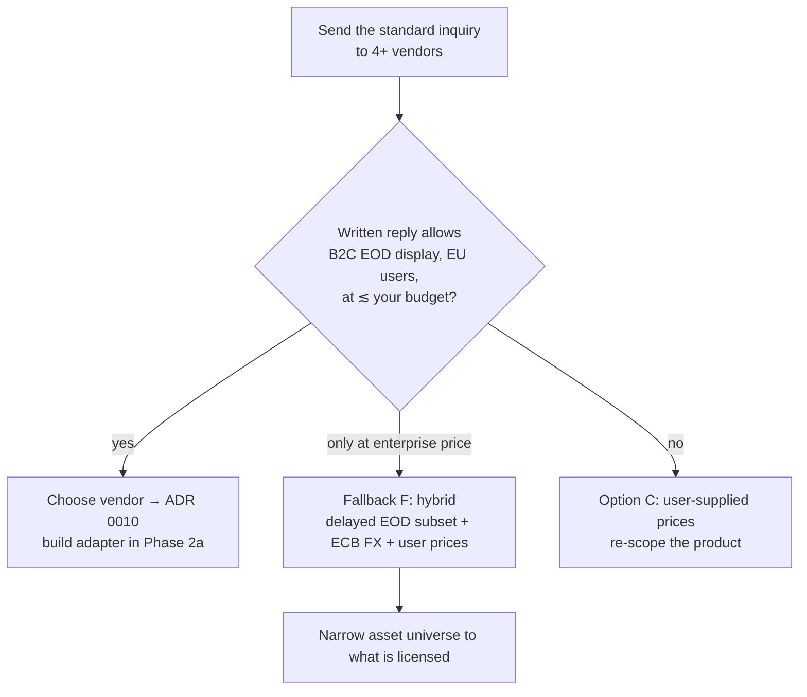
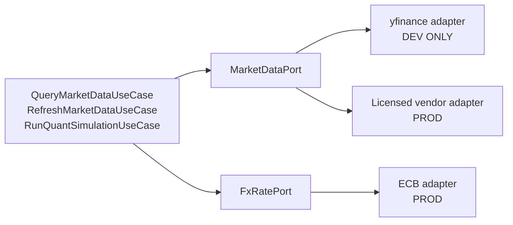

# 06 — Market-data licensing (the hidden launch blocker)

> ⚠ Vendor prices and terms below come from public comparison articles and
> vendor pages as of October 2026. They change often. The plan's Phase 0 task is
> to **get written answers from vendors** — this doc tells you what to ask and
> how to decide.

## 1. The problem

The app looks complete because it shows live-looking prices. Those prices come
from sources that were fine for a **personal tool** and are not fine for a
**product other people pay for**:

| Source in the repo | Current use | Terms in practice | Production verdict |
|--------------------|-------------|-------------------|--------------------|
| `yfinance` (Yahoo) | prices, quotes, FX, news | Unofficial scraper of Yahoo endpoints; Yahoo's terms limit data to personal use, commercial use prohibited; yfinance itself says "for research/educational purposes" | **Not allowed** (ADR 0006) |
| Twelve Data (free key) | calibration backfill | Personal/non-commercial on free/individual plans; separate business licensing for external/commercial display | Needs a business plan |
| Finnhub (free key) | sentiment | Free tier is personal/non-commercial | Needs commercial plan or drop |
| StockTwits public API | sentiment | Public but terms/UA rules; not clearly licensed for commercial redistribution | Treat as **unlicensed** until read & confirmed |
| GDELT | macro headlines | Free, with fair-use limits; check attribution/redistribution terms | Likely OK with attribution; confirm |
| SEC EDGAR | filings | US public-domain data; fair-access rules (identify yourself, ≤10 req/s) | **OK** |
| OpenFIGI | ISIN → listings | Free API with key and rate limits; read the licence on storing/redistributing mappings | Likely OK; confirm |
| ECB reference rates | (proposed) FX | Free reuse incl. commercial with attribution "Source: ECB statistics"; informational only, not for transactions | **OK** for FX valuation display |

The legal concept: when you show a price to a user you are **redistributing**
the data vendor's content, even if only end-of-day. Exchanges own the
underlying data and vendors pass obligations (display fees, attribution,
delay requirements, "no redistribution") down to you.

## 2. Options

| Option | How | Pros | Cons |
|--------|-----|------|------|
| **A. Commercial licence from an aggregator** | Pay for a business/commercial plan from Twelve Data, EODHD, Tiingo, Polygon/Massive, Financial Modeling Prep, Marketstack, etc. | Clear terms, SLA, stable API | Monthly cost; redistribution/display rights often a *higher* tier or "contact sales" |
| **B. Bring-your-own-key (BYOK)** | Each user enters their own personal data-vendor key | Each user's personal licence covers their own use; zero data cost | Terrible UX; stored secrets (conflicts with ADR 0003's spirit); support burden |
| **C. User-supplied prices** | Prices come from the user's own statements/imports; no external feed | Zero licensing | Positions revalue only when users import; weak product |
| **D. Narrow the data you show** | Show only user-derived valuations (quantity × last imported price), hide raw price series and quotes | Reduces redistribution surface | Hollows out the dashboard; vendors may still count it as display |
| **E. Direct exchange licences** | e.g. Euronext/Xetra | Authoritative | Far too expensive/complex for a solo launch |
| **F. Hybrid** | Licensed EOD from a vendor + ECB FX + user-supplied prices for the long tail | Pragmatic | More code paths |

Indicative public pricing (⚠ secondary sources, verify):

| Vendor | Reported tiers (≈) | Licence nuance reported |
|--------|--------------------|-------------------------|
| Tiingo | ~$30/mo individual, ~$50/mo "commercial" | Commercial plan covers *internal* commercial use; **redistribution needs separate written approval** naming use case |
| Twelve Data | ~$29 / $99 / $329 per month; Business from ~$1,099/mo | Personal/non-commercial vs a distinct "commercial, external, professional" licence; public display may need attribution/higher plan/exchange agreements |
| Alpha Vantage | ~$50–$250/mo premium | Premium keys remain under personal licence; commercial = contact for onboarding |
| EODHD | ~$20–$100/mo personal; ~$399/mo commercial internal | Same data, 4× price for the licence; check "display to end users" explicitly |

Key takeaway: **the technical API is cheap; the licence to show it to
customers is the expensive part**, and the cheap self-serve tiers usually
*don't* include it.

## 3. Decision and why

Treat this as a **gate**, run in Phase 0, before investing in the rest:



**The standard inquiry** (send the same email to each vendor; keep replies):

> I'm launching a subscription web app for EU retail investors to track their
> own portfolios across brokers. Users enter or import their own positions; the
> app shows **end-of-day** (not real-time) prices, FX conversion, and charts of
> portfolio value over time. Expected users: 100 in year 1, up to 5,000.
> 1. Does your commercial plan permit **displaying your prices to end users in
>    my app** (not redistributing raw data, no API for third parties)?
> 2. Which **exchanges/instruments** (EU ETFs, funds by ISIN, US stocks) are
>    covered, and do any require **exchange-specific** display fees or
>    attribution?
> 3. Any **delay** requirement (e.g. 15 min / EOD only)?
> 4. Can we **store** historical data in our database permanently?
> 5. Price at 100 / 1,000 / 5,000 users? Rate limits? SLA?
> 6. Are there **restrictions on using the data in AI/LLM features**
>    (summaries, assistants) or in forecasting models?
> 7. Please confirm in writing.

Question 6 matters: several data licences restrict feeding data to AI systems
or redistributing derived datasets; the Quant Lab and assistant both use price
history.

## 4. In this repo

### 4.1 The ports already isolate this

`ports/market_data.py` defines the market-data port; `yfinance` is an adapter.
That is the hexagonal payoff: a vendor swap is a new adapter plus config, not a
rewrite.



### 4.2 Make dev-only sources impossible in production

```python
# config.py (see 01 §4.3)
market_data_provider: Literal["yfinance", "vendor"] = "yfinance"
intel_sources_enabled: set[str] = {"sec_edgar"}            # explicit allow-list per source

# in the startup guard
if app_env == "production":
    assert market_data_provider == "vendor"
    assert intel_sources_enabled <= LICENSED_SOURCES        # {"sec_edgar", "gdelt", ...}
```

### 4.3 What to change in the product

| Feature | Change |
|---------|--------|
| FX (`fx_rates`) | Fill from ECB daily reference rates (free, attributed). Show "FX: ECB reference rates" in the footer/data notes |
| Prices / quotes | Vendor adapter; store with `source`, `fetched_at`, `delay` metadata so the UI can say "End-of-day price, delayed" |
| Quant Lab history | Backfill only from the licensed vendor; check AI/derived-use terms |
| Market Intel | Keep SEC EDGAR; for sentiment, keep only sources with confirmed commercial terms or disable the feature in production; Yahoo news is out |
| Search | Only licensed/curated symbol universe is searchable |
| Attribution | Add a "Data sources" page and per-chart notes as the vendor requires |
| Cache | Don't expose a public price API; keep prices behind auth; rate-limit exports |

### 4.4 Showing delayed data honestly

Always label: "Prices are end-of-day / delayed and may contain errors; sourced
from <vendor>". This is both a licence requirement in many cases and part of
the informational-use posture (ADR 0001).

## 5. What goes wrong in production

- **Cease-and-desist or key revocation** after launch because a free tier was
  used commercially — the single most common indie-SaaS data failure.
- **Silent coverage gaps.** European funds by ISIN often lack coverage at
  cheap vendors; the resolver (`ResolveSecurityUseCase`) may map to a listing
  your vendor doesn't have. Measure coverage on your real asset list during beta.
- **Symbol conventions differ** per vendor (`.DE` vs MIC codes); the adapter
  must translate, and `asset_identifiers` is where those mappings live.
- **Vendor price changes** — keep the port so switching takes days, and budget
  a quarterly price review.
- **Corporate actions** (splits, dividends) handled differently by vendors;
  validate with a golden set before trusting adjusted series.
- **Rate limits at scale.** One shared refresh job over *unique assets* (not
  per user) keeps call counts proportional to assets, not users — a major
  reason Reference data is shared (ADR 0005).
- **Licence limits on storage.** If the vendor forbids long-term storage, the
  `prices` table and Quant history are a problem; ask question 4.

## 6. Checklist

- [ ] Inquiry sent to ≥4 vendors; written replies archived in `docs/legal/vendor-terms/`
- [ ] Vendor chosen (ADR 0010) with display, storage and AI-use rights confirmed
- [ ] ECB FX adapter in; attribution shown
- [ ] `yfinance`/Finnhub/StockTwits impossible to enable in production (startup guard)
- [ ] "Data sources" page + delay labels in UI
- [ ] Coverage of the beta users' real assets measured; gaps handled (private custom assets)
- [ ] Refresh job iterates unique assets, not users
