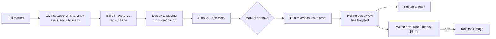
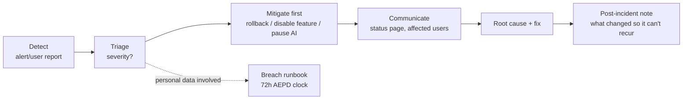

# 08 — Operations and deployment

## 1. The problem

Shipping is not the finish line: a service people depend on must be
deployable without fear, observable when it misbehaves, recoverable when it
breaks, and operable by one person at 3am without heroics. This doc is the
"keep it alive" half of production.

## 2. Options

### 2.1 Hosting (decision Q6: managed EU stack)

Criteria, in priority order: (1) EU region with a DPA, (2) managed Postgres
with **point-in-time recovery**, (3) pgvector support (migration `0006`
needs it only if Tool RAG is enabled), (4) container hosting with rolling
deploys and secrets, (5) predictable price, (6) low lock-in (plain containers +
plain Postgres).

| Candidate type | Examples (⚠ verify current offers) | Notes |
|----------------|-----------------------------------|-------|
| EU cloud with managed DB + containers | Scaleway, OVHcloud, Exoscale, IONOS | EU companies; compare managed Postgres PITR and pgvector |
| Hyperscaler EU region | AWS (Frankfurt/Ireland/Paris), Azure, GCP | Most features, most complexity, US parent (transfer analysis) |
| PaaS with EU region | Render, Fly.io, Railway, Sliplane, Aiven (DB) | Fastest to ship; check regions and DPAs |
| Single VPS (Hetzner, etc.) + Compose | cheapest | You own backups/patching; acceptable only for the closed beta |

**Recommendation:** closed beta on the simplest thing that satisfies (1)–(2);
re-evaluate before public launch using beta cost data. Because the app is plain
containers + Postgres, moving later is a weekend, not a rewrite — protect that
property (no proprietary DB features, no platform-specific SDKs).

### 2.2 Environments

| Env | Purpose | Data |
|-----|---------|------|
| local | development (`docker compose`) | synthetic/your own |
| **staging** | exact production shape, pre-release tests, restore drills | **synthetic only** |
| production | users | real |

Never copy production data into staging/local (05).

## 3. Decision and why

### 3.1 Delivery pipeline



- **Build once, deploy the same image everywhere**; environment differences are
  config only.
- **Rollback** = redeploy the previous image. This works only if migrations are
  backward-compatible (expand/contract, 01 §4.2) — otherwise rollback is a trap.
- Extend the existing `.github/workflows/ci.yml` rather than starting over.

### 3.2 Observability: the four signals

| Signal | What | Tooling examples |
|--------|------|------------------|
| Logs | structured JSON, request id, no financial values | platform logs → EU log store |
| Metrics | request rate/latency/errors, DB connections, job durations, AI cost | Prometheus-style / platform metrics |
| Errors | exceptions with context, scrubbed | EU-hosted error tracker |
| Uptime | external probe of login + a read endpoint | an uptime service + public status page |

**Business/job metrics that matter here:** snapshot build success per day,
market-data refresh age (alert if prices are > 36h stale), import success rate,
worker heartbeat, AI cost vs budget.

### 3.3 Alerting that doesn't wear you out

Page (phone) only for user-visible, urgent symptoms:

| Alert | Threshold example |
|-------|-------------------|
| API 5xx rate | > 2% for 5 min |
| Login failing | synthetic check fails 2× |
| DB unreachable / replication lag | any |
| Prices stale | > 36h |
| Worker heartbeat missing | > 15 min |
| Disk / connections | > 80% |
| AI budget | > 80% of daily budget (ticket, not page) |

Everything else is a daily digest. If an alert fires weekly and you ignore it,
delete it or fix it.

### 3.4 Backups and recovery

| Concept | Target (start here, tighten with experience) |
|---------|-----------------------------------------------|
| **RPO** (max data loss) | ≤ 5 min via PITR/WAL archiving |
| **RTO** (time to restore) | ≤ 4 h (solo operator, honest) |
| Retention | 30 days (aligns with the 05 deletion window) |
| Encryption | at rest; backups in a separate account/bucket from prod |
| Access | few humans, MFA, audited |

**Restore drill monthly** into staging: restore → run the app → verify counts →
**re-apply deletions** that happened after the backup (05 §3.4). Record the
time it took — that *is* your RTO.

Disaster scenarios to rehearse once before launch: database corrupted,
accidental `DELETE` by you, region outage, leaked secret (rotate everything:
DB, provider keys, webhook secrets, session signing).

### 3.5 Incident process (one-person edition)



Feature flags (kill switches) are your best friend: AI off, imports off,
market-data refresh off, new signups off — each a config change, not a deploy.

## 4. In this repo

### 4.1 Containers

- `backend/Dockerfile` → add a non-root user, pinned base image digest, no dev
  dependencies, `HEALTHCHECK`; run via a process manager entrypoint with
  `uvicorn --workers N` or one worker per container.
- Add `backend/app/worker.py` entrypoint (01 §4.1); same image, different command.
- Frontend: static build served by nginx/CDN; set cache headers; no secrets in
  `VITE_*`.
- `docker-compose.yml` remains for local dev. **Remove pgAdmin from anything
  production-like**; it ships default credentials (`admin@…/admin`).

### 4.2 Health endpoints (`api/routes/health.py`)

```python
@router.get("/health/live")   # process is up
def live(): return {"ok": True}

@router.get("/health/ready")  # can serve traffic
def ready(db: Session = Depends(get_raw_db)):
    db.execute(text("SELECT 1"))          # DB reachable
    return {"ok": True, "version": settings.git_sha}
```

### 4.3 Structured logging

`main.py::_configure_logging` already centralises logging; switch the formatter
to JSON, add a request-id middleware, and inject `user_id` (uuid only). Add a CI
test that fails if an obviously sensitive field name (`quantity`, `price`,
`password`, `token`) is passed to the logger in route/service code via a simple
lint rule.

### 4.4 Cost model (rough, to be replaced by beta data)

| Item | Beta (≤10 users) | Early launch (~100–500) | Notes |
|------|------------------|--------------------------|-------|
| Hosting + managed Postgres | €30–80/mo | €80–250/mo | scales slowly |
| Market-data licence | **€50–400/mo** | **€100–1,100+/mo** | dominant and uncertain — see 06 |
| Auth provider | €0–30 | €0–100 | per 02/03 |
| Error tracking, logs, uptime | €0–30 | €30–100 | |
| Email sending | ~€0–20 | €10–30 | |
| LLM (opt-in, paid tier only) | €0 | usage-based, capped | quota per plan |
| Merchant of record fee | — | ~5% + €0.50 per transaction reported | ⚠ verify |
| Domain, misc, lawyer review | one-off ≈ €300–1,000 | | |

All figures are order-of-magnitude placeholders from public price pages and must
be re-priced in Phase 0. The key insight: **fixed data licence costs set your
break-even user count**; compute it before choosing a price (09).

### 4.5 Operational docs to write (`docs/runbooks/`)

1. Deploy and rollback
2. Restore from backup (with deletion re-application)
3. Rotate secrets
4. Market-data outage / stale prices
5. Provider (auth/LLM) outage
6. Suspected breach (links to 05 §3.5)
7. DSAR / deletion request handling
8. Onboarding a new Operator (access, MFA, audit)

## 5. What goes wrong in production

- **Deploy + migration coupling** — covered; use expand/contract and a separate
  migration job.
- **Backups never restored** — schedule the drill; unverified backups fail
  when needed.
- **One engineer, no vacation plan.** Define what happens if you're offline for
  a week: auto-rollback on health failure, status page, an emergency contact
  for the provider accounts (access sharing via a password manager emergency
  kit).
- **Secrets sprawl** across laptop, CI, platform. Inventory them; rotate on a
  schedule and on any suspicion.
- **Alert on everything** → ignore everything.
- **Un-capped autoscaling** → surprise bill (and a DoS becomes a billing event).
  Set maximum replicas and spend alarms.
- **Time-boxed free tiers** of platforms expiring silently.
- **Clock/timezone** assumptions in snapshot jobs across DST (UTC everywhere).
- **Dependency rot.** Schedule monthly dependency/base-image updates through CI.
- **Support as an operational load.** A shared mailbox, a response-time promise
  you can keep, templates for the top 10 questions (import format problems!).

## 6. Checklist

- [ ] Staging mirrors production (synthetic data); same image promoted
- [ ] CI/CD: build once, migration job, health-gated rolling deploy, automated rollback
- [ ] Liveness/readiness endpoints; worker heartbeat
- [ ] JSON logs with request ids; no financial values; error tracker scrubbed
- [ ] Uptime probe + public status page
- [ ] Alerts: only urgent ones page; others digest
- [ ] PITR enabled; monthly restore drill recorded; RPO/RTO documented
- [ ] Kill switches (AI, imports, refresh, signup) as config
- [ ] Spend alarms and max replicas set
- [ ] Runbooks 1–8 written; secrets inventory + rotation drill done
- [ ] pgAdmin/docs endpoints absent; non-root containers; pinned base images
