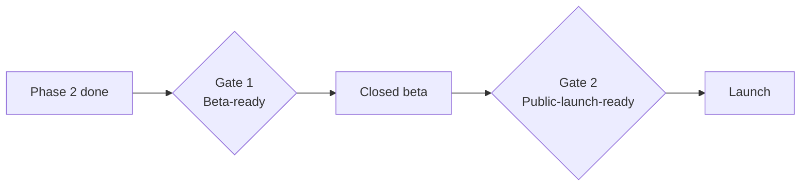

# 10 — Launch checklist

A gate, not a wish list. A box is ticked only with evidence (a link, a test
name, a screenshot, a signed document). Review at the end of Phase 2, before
the closed beta, and again before public launch.

## Gate 1 — ready for the closed beta (5–10 invited users)

### Trust
- [ ] Tenancy suite green in CI (routes, MCP tools, jobs) — link to run
- [ ] Every Private table has `user_id` + forced RLS (introspection test)
- [ ] Runtime DB role is non-owner/`NOBYPASSRLS` (startup check)
- [ ] Every route authenticated except an explicit allow-list (test)
- [ ] Sessions revocable; "log out everywhere" tested; MFA available
- [ ] `user_id`, `plan`, `deleted_at` not client-settable (mass-assignment review)

### Security
- [ ] Headers/CSP/CORS from config; `/docs` off in production
- [ ] Upload limits + sniffing + zip/row caps; no file retention
- [ ] Rate limits on auth, import, quant, intel; per-user keys
- [ ] Secrets in secrets manager; gitleaks/pip-audit/Trivy/SAST in CI
- [ ] Logs and error tracker verified free of financial values
- [ ] Audit log in place; Operator actions logged; Operator requires MFA

### Data and law
- [ ] Market-data vendor licence confirmed in writing (06); `yfinance` blocked in production
- [ ] ECB FX attribution and data-sources page live
- [ ] Privacy Policy, ToS, disclaimer, subprocessor list published (lawyer reviewed)
- [ ] LSSI identification (name, NIF, address, email) on site
- [ ] DPAs accepted for every processor; ROPA + DPIA + breach register exist
- [ ] Export, delete, and (if AI) consent toggle work end to end; purge job tested
- [ ] Beta terms accepted at signup (versioned consent record)

### Operations
- [ ] Staging mirrors production; deploy + rollback rehearsed
- [ ] PITR on; **restore drill done and timed**
- [ ] Health endpoints; worker heartbeat; uptime probe; status page
- [ ] Alerts to your phone for the top 5 failures; runbooks 1–8 exist
- [ ] Kill switches verified (AI, imports, refresh, signup)
- [ ] Spend alarms set

### Product
- [ ] Informational-use wording reviewed across UI, emails, assistant, quant pages
- [ ] No-advice evals pass (if AI on); assistant labelled as AI
- [ ] Import coverage: MyInvestor, IBKR Flex, generic CSV — golden-file tests
- [ ] Private custom assets work; shared asset table cannot be polluted by users

## Gate 2 — ready for public launch

- [ ] Beta exit criteria met: no open Sev-1/2, import success ≥ target, support load manageable
- [ ] Unit economics computed from real beta cost data; price decided (09)
- [ ] ASVS Level 1 walkthrough completed and findings closed
- [ ] Tenancy red-team day done (every route, export, chat, MCP tool, scheduler)
- [ ] Authenticated scan on staging; optional external pen test scheduled/done
- [ ] Billing: MoR test mode end to end + one live low-value transaction; webhooks replay-safe
- [ ] Withdrawal/immediate-start consent verified; refund/cancel flows tested
- [ ] Load test at ≥10× expected traffic with RLS on
- [ ] Incident drill: simulate a breach notification (who, what, forms, 72h clock)
- [ ] Secret-rotation drill completed
- [ ] Dated regulatory items re-verified (AI Act dates, AEPD guidance, vendor terms, MoR fees)
- [ ] `security.txt`, support mailbox, privacy mailbox monitored
- [ ] Rollback plan for launch day; a calm launch window (not Friday evening)

## Post-launch (first 30 days)

- [ ] Daily review of errors, alerts, support mail
- [ ] Weekly: cost per user, data-vendor usage, AI spend vs budget
- [ ] Day 30: first restore drill after launch; dependency update pass; review DSARs
- [ ] Update this doc, the threat model (04) and ROPA with what you learned
