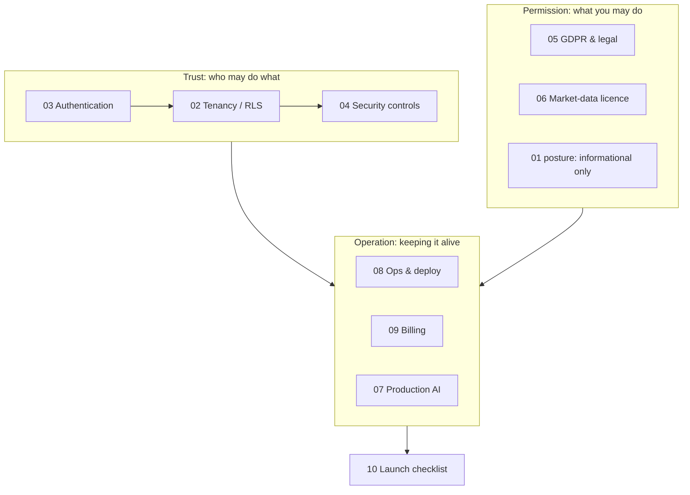

# Taking an AI-assisted app to production — the how and why

This folder explains, step by step, what it takes to turn this local,
single-user investment tracker into a multi-user B2C SaaS that real people can
trust with their financial data. It is written as a learning resource: every
document tells you **what the problem is, what the options are, what we chose
and why, how it looks in this repo, and what usually goes wrong in
production**.

The executable plan is `docs/saas/00-launch-plan.md`. The vocabulary is `CONTEXT.md`.
The individual decisions are `docs/adr/`.

> **Not legal advice.** Regulatory content reflects publicly available
> guidance as researched in October 2026. Dated items are flagged
> "⚠ verify" — re-check them before relying on them, and have a Spanish
> lawyer review your actual legal documents.

## Reading order

| # | Doc | Question it answers |
|---|-----|---------------------|
| 00 | [Launch plan](00-launch-plan.md) | What is the order of work, the phases and the risks? |
| 01 | [Architecture](01-architecture.md) | What does a "production" shape of this app look like, and why is each piece there? |
| 02 | [Multi-tenancy and RLS](02-multi-tenancy-and-rls.md) | How do I guarantee user A never sees user B's data? |
| 03 | [Authentication and sessions](03-authentication-and-sessions.md) | Who is calling, how do I know, and how do I revoke it? |
| 04 | [Security and threat model](04-security-and-threat-model.md) | What can go wrong, and which controls stop it? |
| 05 | [GDPR and legal](05-gdpr-and-legal.md) | What do I owe users and regulators in Spain/EU? |
| 06 | [Market-data licensing](06-market-data-licensing.md) | Can I legally show prices to paying users? (The hidden blocker.) |
| 07 | [Production AI](07-production-ai.md) | How do agents behave safely, cheaply and measurably at scale? |
| 08 | [Operations and deployment](08-operations-and-deployment.md) | How do I ship, observe, back up and survive incidents alone? |
| 09 | [Billing and business model](09-billing-and-business-model.md) | How do I charge, handle VAT, and gate features? |
| 10 | [Launch checklist](10-launch-checklist.md) | Am I actually ready? |

## The template each document follows

1. **The problem** — what breaks if you ignore this.
2. **Options** — the realistic alternatives, with trade-offs.
3. **Decision and why** — what we chose for *this* product and the reasoning.
4. **In this repo** — concrete code and files, with before/after examples.
5. **What goes wrong in production** — the failure modes people only learn the hard way.
6. **Checklist** — items you can tick.

## The big picture in one diagram

The three columns are intentionally separate: you can write perfect code
(Trust) and still be unable to launch because of a licence (Law) or because
nobody gets paged at 3am (Operation).

## Glossary shortcuts

Use the terms from `CONTEXT.md` consistently: **User** (login), **Brokerage
Account** (broker side), **Private data** vs **Reference data**,
**Import** vs **Sync**, **Operator**, **Informational use**.
